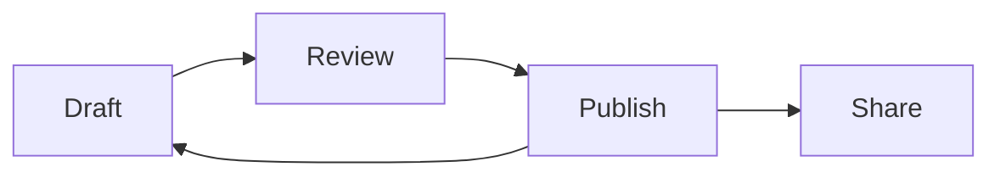
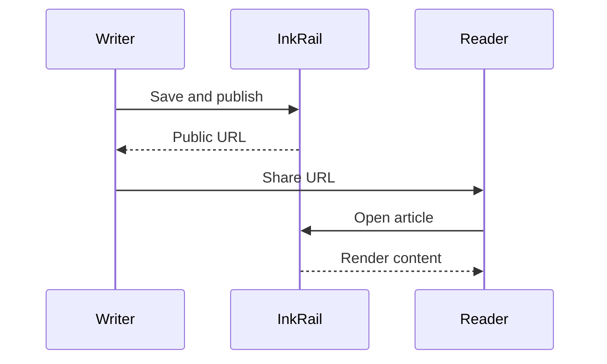

Explore diagrams, charts, file trees, and interactive quizzes. Chart values below are illustrative.

## Flowcharts

### Syntax

````markdown

````

### Preview


## Sequence diagrams

### Syntax

````markdown

````

### Preview


## Bar charts

### Syntax

````markdown
```chart:bar
_title: Documentation readiness (sample)
_min: 0
_max: 10
Syntax: 9
Examples: 7
Review: 5
Publishing: 3
```
````

### Preview

```chart:bar
_title: Documentation readiness (sample)
_min: 0
_max: 10
Syntax: 9
Examples: 7
Review: 5
Publishing: 3
```

## Radar charts

### Syntax

````markdown
```chart:radar
_title: Article review (sample)
_min: 0
_max: 5
Readability: 4
Examples: 5
Accuracy: 4
Structure: 3
Diagrams: 4
```
````

### Preview

```chart:radar
_title: Article review (sample)
_min: 0
_max: 5
Readability: 4
Examples: 5
Accuracy: 4
Structure: 3
Diagrams: 4
```

## File trees

### Syntax

````markdown
```tree
inkrail/
  app/
    Models/
      Article.php
  resources/
    js/
      components/
        article-content.tsx
      pages/
        articles/
          public-show.tsx
  routes/
    web.php
```
````

### Preview

```tree
inkrail/
  app/
    Models/
      Article.php
  resources/
    js/
      components/
        article-content.tsx
      pages/
        articles/
          public-show.tsx
  routes/
    web.php
```

## Quizzes

### Syntax

````markdown
Select an answer, then submit it. Results are not stored on the server.

```quiz
question: Who can read a draft article?
A: Anyone with its URL
B: Its owner
C: Every signed-in user
correct: B
correctMessage: Correct
incorrect: Try another answer
hint: Think about ownership and publication status.
explanation: Only the owner can read a draft in the management area. Its public URL returns 404.
```
````

### Preview

Select an answer, then submit it. Results are not stored on the server.

```quiz
question: Who can read a draft article?
A: Anyone with its URL
B: Its owner
C: Every signed-in user
correct: B
correctMessage: Correct
incorrect: Try another answer
hint: Think about ownership and publication status.
explanation: Only the owner can read a draft in the management area. Its public URL returns 404.
```

## Stable heading IDs {#stable-heading}

### Syntax

```markdown
[Link to this heading](#stable-heading).
```

### Preview

[Link to this heading](#stable-heading).

## Features requiring integration

- Wikilinks such as `[[Article]]` need an application resolver.
- Rich link-card metadata needs an OGP endpoint.
- Generative UI needs explicit opt-in and application event handling; it is not enabled for ordinary articles.

## Explore the other guides

- [Basic Markdown — Writing fundamentals](./showcase-markdown)
- [Zenn flavor — Messages and disclosures](./showcase-zenn)
- [GitHub flavor — Tables, tasks, and alerts](./showcase-gfm)
- [Mintlify flavor — Composing documentation](./showcase-mintlify)
