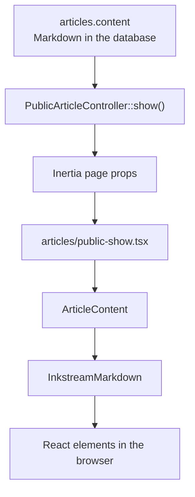

InkRail is both a live demo of Inkstream and a small example of integrating it into a Laravel application with Inertia.js and React. This guide follows the code used to render this very page.

## The rendering path



Inertia delivers the page component and its data. Inkstream interprets the Markdown. The database keeps the original Markdown string rather than a rendered HTML copy.

## 1. Load and authorize the article

The public route binds an article by its slug:

```php
Route::get('p/{article:slug}', [PublicArticleController::class, 'show'])
    ->name('public.articles.show');
```

The controller checks publication before returning the page. An unpublished article produces a 404, even if someone knows its slug.

The central part of `PublicArticleController::show()` is:

```php
abort_unless($article->is_published, 404);

return Inertia::render('articles/public-show', [
    'article' => $article->only(['title', 'content', 'slug']),
    'editableArticleId' => $request->user()?->can('update', $article)
        ? $article->id
        : null,
    'publicIndexEnabled' => (bool) config('articles.public_index_enabled'),
]);
```

The article title, Markdown content, and slug become props of the React page. Separate props control the management link and the public-index navigation.

## 2. Select the React page

The component name `articles/public-show` identifies `resources/js/pages/articles/public-show.tsx` through the application's Inertia/Vite integration.

In `resources/js/app.tsx`, the public pages return `null` from the layout selector. They supply their own public header and content container instead of inheriting the management layout.

A shortened version of the public page's rendering call is:

```tsx
<ArticleContent
    content={article.content}
    syntax={article.slug === 'showcase-zenn' ? 'zenn' : 'all'}
/>
```

This showcase chooses the Zenn profile for the `showcase-zenn` slug. Other articles use the existing all-features pipeline. The profile is selected in the application; it is not a separate database field in InkRail today.

## 3. Render with Inkstream

`resources/js/components/article-content.tsx` is the shared rendering boundary for public pages and authenticated article pages:

```tsx
import {
    InkstreamMarkdown,
    type SyntaxProfile,
} from '@catatsumuri/inkstream/react';

export default function ArticleContent({
    content,
    syntax = 'all',
}: {
    content: string;
    syntax?: SyntaxProfile;
}) {
    return (
        <InkstreamMarkdown className="min-w-0" syntax={syntax}>
            {content}
        </InkstreamMarkdown>
    );
}
```

Pass the Markdown string as children. Inkstream performs its normalization and parser transforms, then renders the resulting elements through React components. InkRail does not pre-render the article body into an HTML string or insert it with `dangerouslySetInnerHTML`.

The `min-w-0` class allows the renderer to shrink inside its container. Code blocks and other wide content have their own presentation inside that boundary.

## 4. Choose an authoring profile

```tsx
// Standard Markdown plus Zenn's authoring dialect.
<InkstreamMarkdown syntax="zenn">{content}</InkstreamMarkdown>

// Standard Markdown without the extended dialects.
<InkstreamMarkdown syntax="basic">{content}</InkstreamMarkdown>

// The existing combined pipeline; also the default when omitted.
<InkstreamMarkdown syntax="all">{content}</InkstreamMarkdown>
```

The Zenn profile includes tables, math, footnotes, Zenn messages and disclosures, and provider embeds. Mintlify tags such as `<Note>` stay literal in that profile. See the [Zenn guide](./showcase-zenn) and [Mintlify guide](./showcase-mintlify) to compare them.

## 5. Load the stylesheet

`resources/css/app.css` imports the application's Inkstream stylesheet:

```css
@import './inkstream.css';
```

That file imports the package styles and maps their semantic colors onto InkRail's theme variables. For example:

```css
@import '@catatsumuri/inkstream/styles.css';

.ink-markdown {
    --ink-border: var(--border);
    --ink-foreground: var(--foreground);
    --ink-muted: var(--muted);
    --ink-primary: var(--primary);
}
```

The actual file also maps muted foreground, primary foreground, accent, and card colors. These variables let package components follow the application's light and dark themes.

## Initial rendering and browser behavior

The Vite configuration includes `@inertiajs/vite`. When Inertia server-side rendering is active, the same React component can produce the initial article markup on the server and hydrate in the browser. InkRail does not maintain a second article-body rendering template for SSR.

Some components still need browser work: code highlighting initializes its highlighter, Mermaid draws diagrams, and GitHub file excerpts fetch source content. A successful page render does not guarantee that an external provider is reachable. Link-card metadata also needs an OGP endpoint; InkRail currently does not pass one.

## Follow the source

These files are the main integration points in the [InkRail repository](https://github.com/catatsumuri/inkrail):

- [PublicArticleController.php](https://github.com/catatsumuri/inkrail/blob/main/app/Http/Controllers/PublicArticleController.php) selects published article data.
- [public-show.tsx](https://github.com/catatsumuri/inkrail/blob/main/resources/js/pages/articles/public-show.tsx) provides the public page and chooses the profile.
- [article-content.tsx](https://github.com/catatsumuri/inkrail/blob/main/resources/js/components/article-content.tsx) wraps the package renderer.
- [inkstream.css](https://github.com/catatsumuri/inkrail/blob/main/resources/css/inkstream.css) connects package styling to the application theme.
- [vite.config.ts](https://github.com/catatsumuri/inkrail/blob/main/vite.config.ts) configures the Laravel, Inertia, and React build integration.

For package usage outside this application, read the [Inkstream README](https://github.com/catatsumuri/inkstream/blob/v0.13.0/README.md).
