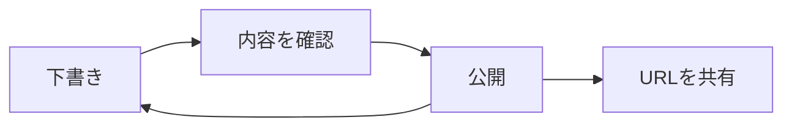
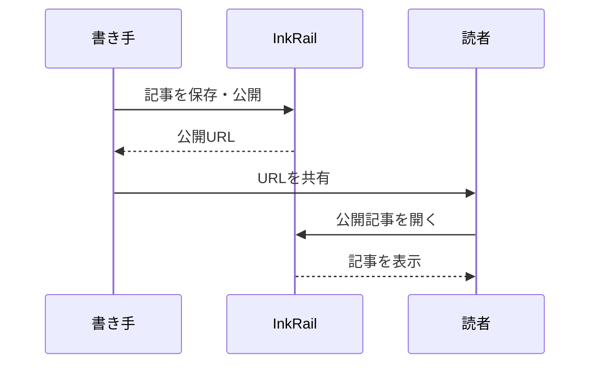

ここでは、基本Markdown・Zenn・Mintlify風・GFMの分類だけでは収まらない図表やインタラクティブな表示を紹介します。コードフェンスの言語名を変えると、図・チャート・ツリー・クイズとして描画できます。

## Mermaid：フローチャート

````markdown

````


## Mermaid：シーケンス図

````markdown

````


## 棒グラフ

`_title` はタイトル、`_min` と `_max` は値の範囲です。それ以外の行を `ラベル: 数値` で書きます。以下の数値はサンプルです。

````markdown
```chart:bar
_title: ドキュメントの準備状況（サンプル）
_min: 0
_max: 10
基本構文: 9
使用例: 7
レビュー: 5
公開準備: 3
```
````

```chart:bar
_title: ドキュメントの準備状況（サンプル）
_min: 0
_max: 10
基本構文: 9
使用例: 7
レビュー: 5
公開準備: 3
```

## レーダーチャート

````markdown
```chart:radar
_title: 記事のチェック（サンプル）
_min: 0
_max: 5
読みやすさ: 4
具体例: 5
正確さ: 4
構成: 3
図解: 4
```
````

```chart:radar
_title: 記事のチェック（サンプル）
_min: 0
_max: 5
読みやすさ: 4
具体例: 5
正確さ: 4
構成: 3
図解: 4
```

## ファイルツリー

`tree` フェンスでは、インデントを付けたパスや `tree` コマンド風の出力を表示できます。フォルダーを開閉してみてください。

````markdown
```tree
inkrail/
  app/
    Models/
      Article.php
  resources/
    js/
      components/
        article-content.tsx
      pages/
        articles/
          public-show.tsx
  routes/
    web.php
```
````

```tree
inkrail/
  app/
    Models/
      Article.php
  resources/
    js/
      components/
        article-content.tsx
      pages/
        articles/
          public-show.tsx
  routes/
    web.php
```

## クイズ

選択肢を選び、回答ボタンを押してみてください。表示上の練習問題で、成績をサーバーに保存する機能ではありません。

````markdown
```quiz
question: 下書きの記事を閲覧できるのは誰ですか？
A: URLを知っている全員
B: 記事の所有者
C: ログインしている全員
correct: B
correctMessage: 正解です
incorrect: もう一度考えてみましょう
hint: 公開状態と所有者の権限を思い出してください。
explanation: 下書きは所有者だけが管理画面から閲覧でき、公開URLは404になります。
```
````

```quiz
question: 下書きの記事を閲覧できるのは誰ですか？
A: URLを知っている全員
B: 記事の所有者
C: ログインしている全員
correct: B
correctMessage: 正解です
incorrect: もう一度考えてみましょう
hint: 公開状態と所有者の権限を思い出してください。
explanation: 下書きは所有者だけが管理画面から閲覧でき、公開URLは404になります。
```

## 明示的な見出しID {#stable-heading}

見出しに `{#stable-heading}` を付けると、見出しの文言を変えても同じアンカーを使えます。[この見出しへ](#stable-heading)のように参照できます。

```markdown
## 明示的な見出しID {#stable-heading}

[この見出しへ](#stable-heading)
```

## オプションが必要な機能

- **Wikilink**：`[[記事名]]` は、アプリがリンク解決を設定した場合に使えます。このアプリではまだ設定していません。
- **リッチなリンクカード**：タイトル・概要・画像の取得には、アプリ側のOGP取得機能が必要です。
- **Generative UI**：入力欄・フォーム・ボタンは明示的な有効化とアプリのイベント処理が必要です。通常の記事描画では有効にしていません。

このページでは、現在のアプリで操作できる機能と、追加の連携が必要な機能を区別しています。

## 次に読む

[基本Markdown](./showcase-markdown) · [Zennフレーバー](./showcase-zenn) · [Mintlifyフレーバー](./showcase-mintlify) · [GitHubフレーバー](./showcase-gfm)
