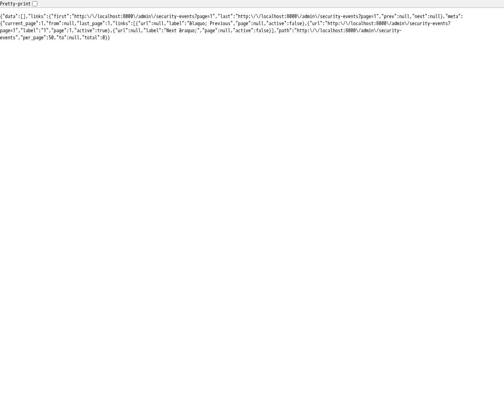
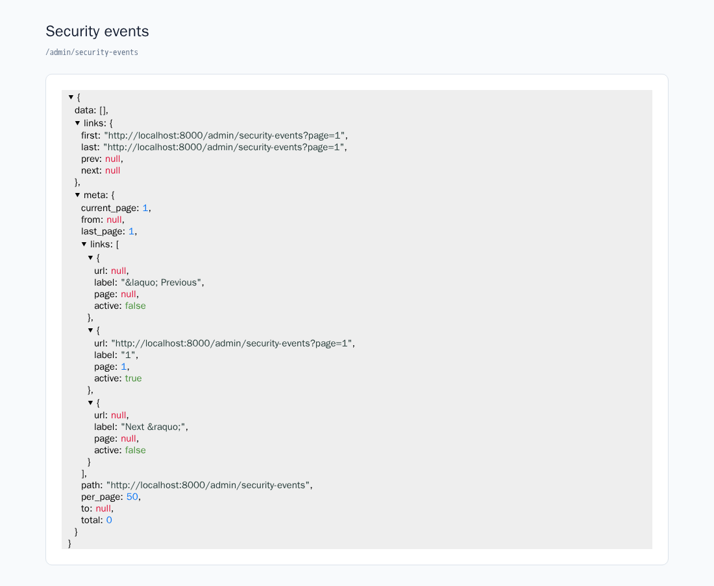

Important account changes and rejected authentication attempts are stored in the database. This gives operators records to investigate, separately from the [account change emails](../security/#account-change-notifications) sent to users.

## Recorded events

Events use the log name `security`. Their result is either `success` or `failure`.

### Successful operations

| Event | Operation |
| --- | --- |
| `email.changed` | Email address change |
| `password.changed` | Password change from settings |
| `password.reset` | Completed password reset |
| `mfa.enabled` | Two-factor authentication enabled |
| `mfa.disabled` | Two-factor authentication disabled |
| `mfa.recovery_codes.regenerated` | Recovery codes generated or regenerated |
| `passkey.created` | Passkey added |
| `passkey.deleted` | Passkey deleted |
| `account.deleted` | Account deleted |

When two-factor setup requires a confirmation code, `mfa.enabled` is recorded only after successful confirmation. For `mfa.disabled`, `properties.was_active` indicates whether it was active before removal.

### Rejected operations

| Event | Failure |
| --- | --- |
| `login.failed` | Email and password login rejected |
| `mfa.failed` | Incorrect two-factor or recovery code during login |
| `email.change_failed` | Current password validation failed during an email change |
| `password.change_failed` | Current password validation failed during a password change |
| `password.reset_failed` | Password reset rejected, such as for an invalid token |
| `account.delete_failed` | Password validation failed during account deletion |

This is not a record of every HTTP error. A mismatched new-password confirmation or a request rejected before processing by a [rate limit](../security/#rate-limits) is different from these authentication failures. This implementation does not record session revocation or failed passkey authentication as security events.

### Stored information

Each record includes the event, result, subject user ID, acting user ID, timestamp, and event-specific properties. IDs can be `null` when a subject or actor cannot be identified. For example, a failed login for an unknown address has no subject user.

Properties can include a passkey ID (`passkey_id`), the two-factor method (`method`: `totp` or `recovery_code`), or a reset failure reason (`reason`). Account deletion preserves the deleted user's ID in `properties.user_id`.

Passwords, authentication codes, reset tokens, and raw submitted values such as email addresses or passkey names are not passed to this logging action. IP addresses and User-Agent values are not automatically added to this log. Investigations that need the source address must use separately configured access logs or other evidence.

Logging failures are reported and do not stop the original operation. The absence of a record alone does not prove that an operation did not happen.

## Access control and JSON endpoint

### Configuring viewers

Set a comma-separated list of permitted users' email addresses in `.env`.

```dotenv
AUDIT_SECURITY_VIEWERS=test@example.com
```

Rebuild cached configuration after changes.

```sh
php artisan config:cache
```

Viewing requires a signed-in user with a verified email address on the allowlist. Matching is case-insensitive. An empty list allows nobody to view the events.

:::caution[Verified email is required]
Access is based on a verified email address. If email verification was excluded during installation and the user model does not implement `MustVerifyEmail`, viewing is denied as well.
:::

The `view-security-events` Gate in `app/Providers/AppServiceProvider.php` contains this check. Change that Gate if the application needs role-based access instead.

### Retrieving JSON

Sign in as an allowed user and open `/admin/security-events`. It returns read-only JSON. There is no built-in administration screen or API token authentication for this endpoint.

:::note[Provide your own presentation]
The response is raw JSON. Implement lists, search forms, and formatting in the consuming application as needed. The formatted example below is not a standard administration screen provided by the kit.
:::

The screenshot was taken after allowing the verified `test@example.com` account and receiving HTTP `200`. There were no events at capture time, so `data` is empty and `meta.total` is `0`.

<figure>



<figcaption>Security events JSON retrieved by an authorized user</figcaption>
</figure>

```text
GET /admin/security-events
GET /admin/security-events?result=failure
GET /admin/security-events?event=password.changed
GET /admin/security-events?result=failure&event=login.failed&page=2
```

Results are ordered by descending ID, with 50 records per page. Filter `result` by `success` or `failure`, or `event` by an exact event name of up to 100 characters. Filters can be combined.

The response contains records in `data` and pagination information in `links` and `meta`.

| Field | Meaning |
| --- | --- |
| `id` | Log record ID |
| `event` | Event name |
| `result` | `success` or `failure` |
| `subject_id` | Subject user ID, or `null` when unavailable |
| `causer_id` | Acting user ID, or `null`, for example for unauthenticated operations |
| `properties` | Result and event-specific properties |
| `created_at` | Record timestamp in ISO 8601 format |

### Example record

The following is an illustrative record from the `data` array, not an actual production record or a screenshot of captured data. IDs and timestamps are fictional. A successful password change includes `result` in both the top-level field and `properties`.

```json
{
  "id": 123,
  "event": "password.changed",
  "result": "success",
  "subject_id": 42,
  "causer_id": 42,
  "properties": {
    "result": "success"
  },
  "created_at": "2026-11-09T00:00:00.000000Z"
}
```

A signed-in user without viewing permission receives HTTP `403`. Requests to add, update, or delete records through this endpoint are not accepted.

:::note[Format the response in your application]
The endpoint returns raw JSON. Provide formatting or an administration screen in the consuming application. This screenshot shows one possible presentation.

<figure>



<figcaption>Example presentation using <a href="https://github.com/anyroad/react-json-view-lite">react-json-view-lite</a> (not a standard administration screen)</figcaption>
</figure>
:::

## Retention and cleanup

### Setting the retention period

Security events are retained for **365 days** by default. Configure the period in `.env`.

```dotenv
AUDIT_SECURITY_RETENTION_DAYS=365
```

This sets `retention_days.security` in `config/audit.php`. Run `php artisan config:cache` after changes if configuration is cached.

Use an integer of at least 1. Invalid values prevent cleanup for that log from being scheduled and report a configuration error. `0` does not mean immediate deletion.

### Running scheduled cleanup

`routes/console.php` schedules expired-record cleanup once per day. The Laravel scheduler must actually run in the deployment environment; configuration alone does not delete records.

For example, call the scheduler every minute from cron, adjusting the path to the deployed application.

```text
* * * * * cd /path/to/app && php artisan schedule:run >> /dev/null 2>&1
```

Inspect scheduled tasks with `php artisan schedule:list`. For continuous local execution, use `php artisan schedule:work`.

### Manual cleanup

The following deletes records in the `security` log whose timestamps are more than 365 days old. Check the log name and period before running it.

```sh
php artisan activitylog:clean security --days=365
```

Add `--force` to skip production confirmation. Scheduled cleanup includes the configured log, period, and `--force`. A manual `--days` value determines its own deletion range and can be shorter than the configured retention period.

:::note[Scope of update and delete protection]
`App\Models\Activity` prevents updating and deleting security records through that model. Retention cleanup intentionally uses bulk deletion. This protection does not prevent raw SQL or bulk operations that bypass model events.
:::
