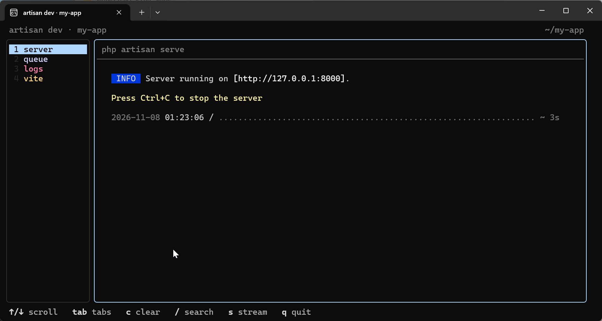
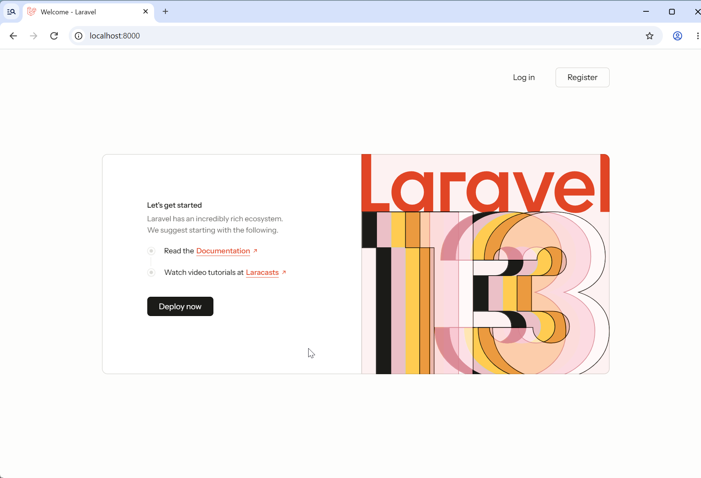
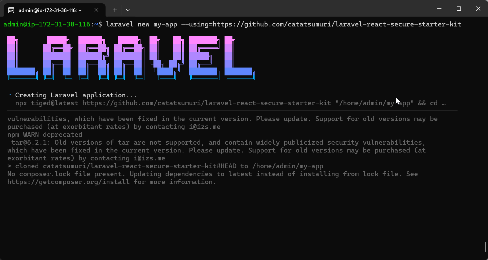

Once you have prepared the [system requirements](../), use the Laravel Installer to create your application. This guide uses SQLite and skips Laravel Boost.

Creation through welcome-page display has been verified on Debian ARM64 (EC2 `t4g.small`) with PHP 8.4.27, Node.js 24.22.2, and npm 11.19.1.

## 1. Check your tools

```sh
php --version
composer --version
node --version
npm --version
```

Node.js and npm are needed **before running `laravel new`**. The Installer also uses `npx` to fetch the kit from GitHub. Their installation steps are outside this guide.

The following packages were installed on the Debian test environment:

```sh
sudo apt install composer git php-xml php-bcmath php-sqlite3
```

`php-xml` and `php-bcmath` were needed for Composer dependencies; `php-sqlite3` was needed for SQLite migrations.

## 2. Install the Laravel Installer

```sh
composer global require laravel/installer
export PATH="$PATH:$(composer global config bin-dir --absolute)"
laravel --version
```

The `export` makes Composer's global commands available in the current terminal. To keep them available after logging in again, add the same line to your shell configuration, such as `~/.bashrc`.

## 3. Create your application

Run this in the directory where you want to create the project. `my-app` is the new directory name; choose a name that does not already exist.

```sh
laravel new my-app \
  --using=https://github.com/catatsumuri/laravel-react-secure-starter-kit \
  --no-boost
```

`--using` selects this kit's GitHub URL. The Installer fetches its files with `tiged` and installs Composer dependencies. `--no-boost` skips the optional Laravel Boost installation.

We recommend starting with `--no-boost` to verify application installation and startup, then adding Boost later if you need its AI development tools.

Installation with Boost has also completed successfully during testing. One attempt failed during Boost initialization inside the Installer, while a manual retry and a subsequent fresh installation succeeded. The cause of that failure remains undetermined.

## 4. Select authentication features

The Installer displays the following selection:

```text
Which authentication features would you like to enable?

  Email verification
  Registration
  Two-factor authentication
  Passkeys
  Password confirmation
```

Press Space to toggle a feature and Enter to confirm. For an initial tour of the kit, leave every feature enabled.

| Feature | Purpose |
| --- | --- |
| Email verification | Verify users' email addresses |
| Registration | Allow new users to register |
| Two-factor authentication | Enable two-factor authentication |
| Passkeys | Enable passkey authentication |
| Password confirmation | Ask for the password again before sensitive actions |

[Chisel](https://github.com/laravel/chisel) removes code and configuration for the features you deselect. **Removing Password confirmation also removes the browser-based session management page.**

The Installer then generates Wayfinder resources, runs database migrations, sets up the test environment, installs npm packages, and builds assets. Pest was configured in the verified run.

When you see `Application ready`, project creation is complete.

## 5. Start development services

```sh
cd my-app
composer run dev
```

This starts the development server, queue worker, log viewer, and Vite together. Switch between their tabs in the terminal to inspect each process.

<figure>



<figcaption>composer run dev terminal with server, queue, logs, and vite tabs; the PHP server is listening on 127.0.0.1:8000</figcaption>
</figure>

The command **keeps the terminal occupied while running**. Open another terminal to run other commands without stopping the services. For SSH, open another connection. Stop the development command with `Ctrl+C`.

## 6. Check the application in your browser

Open <http://localhost:8000>. The Welcome page with **Log in / Register** in the upper-right corner confirms that the application starts and its initial page renders.

<figure>



<figcaption>Laravel Welcome page at localhost:8000 with Log in and Register buttons</figcaption>
</figure>

This verifies startup and welcome-page rendering. Registration, login, and the individual security features still need their own checks.

<details>
<summary>Opening an application on an SSH server, such as EC2</summary>

`localhost` refers to the computer running your browser. If the development server runs remotely, use SSH port forwarding from your own computer to access it at the same URL.

```sh
ssh -L 8000:127.0.0.1:8000 -L 5173:127.0.0.1:5173 admin@YOUR_SERVER
```

Replace `YOUR_SERVER` with your connection destination. Add the same identity-file option you normally use for SSH if needed. Port 8000 is the application; 5173 is Vite's default port. Keep the forwarding connection open while using the browser.

</details>

## Optional: add Laravel Boost later

After verifying that the application starts, you can add Boost as a development dependency if needed. Run these commands from the project root (`my-app`). If development services are running, use another terminal.

```sh
composer require laravel/boost --dev
php artisan boost:install
```

Follow the `boost:install` prompts to select the AI agents you use. The command generates guidelines and configuration files for your selections. See the [official Laravel Boost installation guide](https://laravel.com/framework/docs/boost#installation) for details.

## If installation stops

<details>
<summary>Creating Laravel application fails</summary>

`npm WARN exec` and `npm WARN deprecated` alone do not establish a fetch failure. Inspect the subsequent output.

<figure>



<figcaption>Terminal showing tiged fetching the kit from GitHub, followed by Composer processing</figcaption>
</figure>

If you see `cloned ... to .../my-app`, the files have been fetched. Check the following Composer step:

```sh
cd my-app
composer install
```

In the verified environment, this exposed a missing `ext-xml` extension. Install the missing extensions before retrying.

</details>

<details>
<summary>Database migration fails</summary>

For SQLite, check the PHP SQLite driver. On the Debian test environment, installing the following package allowed migrations to succeed:

```sh
sudo apt install php-sqlite3
```

If the Installer reported an earlier error, do not rely on the final `Application ready` message alone. Also check migrations from the project directory:

```sh
php artisan migrate
```

</details>
