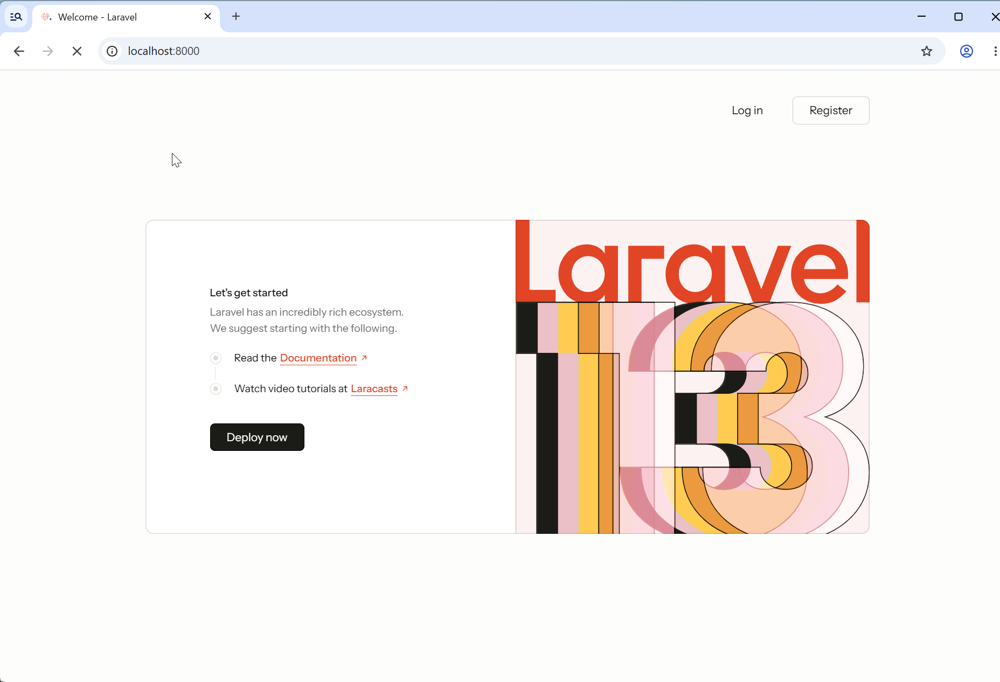
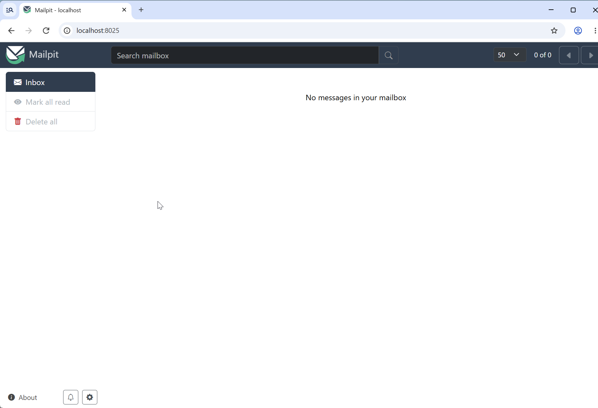

Use Laravel Sail to develop inside Docker containers. This guide uses **SQLite and Mailpit**.

Container builds, the application welcome page, and the Mailpit inbox have been verified on Debian ARM64 (EC2 `t4g.small`).

## 1. Prepare your environment

Make Docker and Docker Compose available. This workflow also uses Git, PHP, Composer, Node.js, and npm on the host while preparing the containers. Check the [system requirements](../).

```sh
docker --version
docker compose version
```

## 2. Fetch the kit

Clone the repository directly. Use a directory name that does not already exist in place of `my-app`.

```sh
git clone https://github.com/catatsumuri/laravel-react-secure-starter-kit.git my-app
cd my-app
cp .env.example .env
composer install --ignore-platform-reqs
```

`--ignore-platform-reqs` skips host PHP version and extension checks while obtaining the files needed to prepare Sail. It does not guarantee compatibility inside the container; check that later. Composer scripts still execute on the host and need the tools and extensions required by those scripts.

Chisel prompts you to select authentication features. Press Space to toggle selections and Enter to confirm. For an initial check, you can leave all features enabled.

```text
Which authentication features would you like to enable?

  Email verification
  Registration
  Two-factor authentication
  Passkeys
  Password confirmation
```

Removing Password confirmation also removes the browser-based session management page.

## 3. Select Sail services

```sh
php artisan sail:install
```

In the service selection, **deselect the default mysql selection and select mailpit**. Use Space to toggle selections, then Enter to confirm.

- **Database:** add no database service for this walkthrough, retaining `DB_CONNECTION=sqlite` in `.env`.
- **Mailpit:** use it to inspect development email such as verification messages, password resets, and change notices.

Omitting a database service does not itself change arbitrary database settings to SQLite. This kit's `.env.example` already selects SQLite, so that setting is retained.

The first installation pulls the Mailpit image and builds Sail's application image. Wait for the PHP, Node.js, and other environment setup to finish.

`Sail scaffolding installed successfully` confirms that Sail setup has completed.

## 4. Choose a port and start containers

This walkthrough uses port 8000 in the browser. Add or check these settings in `.env`:

```dotenv
APP_PORT=8000
APP_URL=http://localhost:8000
```

`APP_PORT` controls the application port exposed on your computer. The default is 80. It is separate from Vite's port.

Start containers in terminal 1:

```sh
./vendor/bin/sail up
```

Keep that terminal open. Open another terminal, or another SSH connection, and continue from the same `my-app` directory.

To create and start containers in the background, including after a port change, use `./vendor/bin/sail up -d`.

## 5. Prepare the application key and database

From here, use Sail to run commands inside the container.

```sh
./vendor/bin/sail composer check-platform-reqs
./vendor/bin/sail artisan key:generate
./vendor/bin/sail artisan migrate --seed
```

The first command checks that container PHP and extensions meet the installed dependencies' requirements. Resolve missing requirements in the container environment before continuing. If migration asks to create the SQLite file, confirm its creation.

<details>
<summary>Resetting a disposable test database</summary>

The verification run initialized its database with the following command. **It deletes existing tables and data, so use it only for a disposable test database.**

```sh
./vendor/bin/sail artisan migrate:fresh --seed --force
```

</details>

## 6. Start Vite+

Run this in terminal 2:

```sh
./vendor/bin/sail npm run dev
```

Vite+ runs using Node.js inside the container. `Inertia SSR dev endpoint: /__inertia_ssr` is a startup message. Keep this terminal open while it runs.

## 7. Open the application and Mailpit

| Destination | URL |
| --- | --- |
| Application | <http://localhost:8000> |
| Mailpit | <http://localhost:8025> |

Check that the application displays the Welcome page with **Log in / Register**.



Selecting Mailpit makes Sail update the email settings in `.env`:

```dotenv
MAIL_MAILER=smtp
MAIL_HOST=mailpit
MAIL_PORT=1025
```

Port 8025 is the browser inbox interface. Application email is sent between containers to `mailpit:1025`.



The inbox starts empty. Verification so far covers the Mailpit interface, not email receipt. Test receipt separately by triggering an action such as email verification or a password reset.

<details>
<summary>Opening an application on an SSH server</summary>

Forward the application, Vite, and Mailpit ports from your computer:

```sh
ssh -L 8000:127.0.0.1:8000 -L 5173:127.0.0.1:5173 -L 8025:127.0.0.1:8025 admin@YOUR_SERVER
```

Use your usual SSH destination and identity-file option if needed. Keep the forwarding connection open while using the browser.

</details>

## Optional: use Pest

A directly cloned project uses PHPUnit by default. To switch to Pest, install it manually from the project root while the containers are running.

```sh
./vendor/bin/sail composer remove phpunit/phpunit --dev
./vendor/bin/sail composer require pestphp/pest --dev --with-all-dependencies
./vendor/bin/sail pest --init
```

This kit declares `phpunit/phpunit` as a development dependency, so include `--dev` when removing it. Follow the initialization prompts.

### Convert existing tests to Pest syntax

To convert the existing PHPUnit tests to Pest syntax, add the Drift plugin and run the conversion. `--drift` rewrites files under `tests/`, so review the resulting diff.

```sh
./vendor/bin/sail composer require pestphp/pest-plugin-drift --dev
./vendor/bin/sail pest --drift
```

The verification run reported 25 converted files as shown below. The count depends on the selected features and kit revision.

```text
INFO  The [tests] directory has been migrated to PEST with 25 files changed.
```

### Run the tests

Successful conversion does not establish that tests pass. Run the tests next and check the results:

```sh
./vendor/bin/sail pest
```

See the [official Pest installation guide](https://pestphp.com/docs/installation) and [PHPUnit migration guide](https://pestphp.com/docs/migrating-from-phpunit-guide) for details.

## Optional: add Laravel Boost

This workflow does not use `laravel new`, so add Boost manually if needed. Run these commands from the project root while the containers are running:

```sh
./vendor/bin/sail composer require laravel/boost --dev
./vendor/bin/sail artisan boost:install
```

Follow the prompts to select the AI agents you use.

## Stop development services

Stop the Vite+ command with `Ctrl+C`. To stop containers, run this from the project root:

```sh
./vendor/bin/sail down
```
