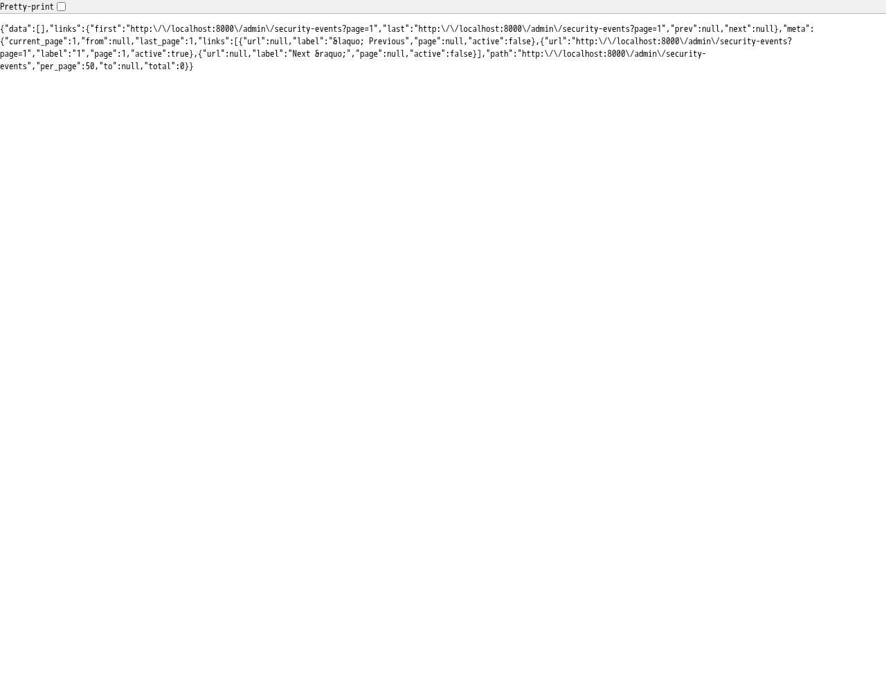
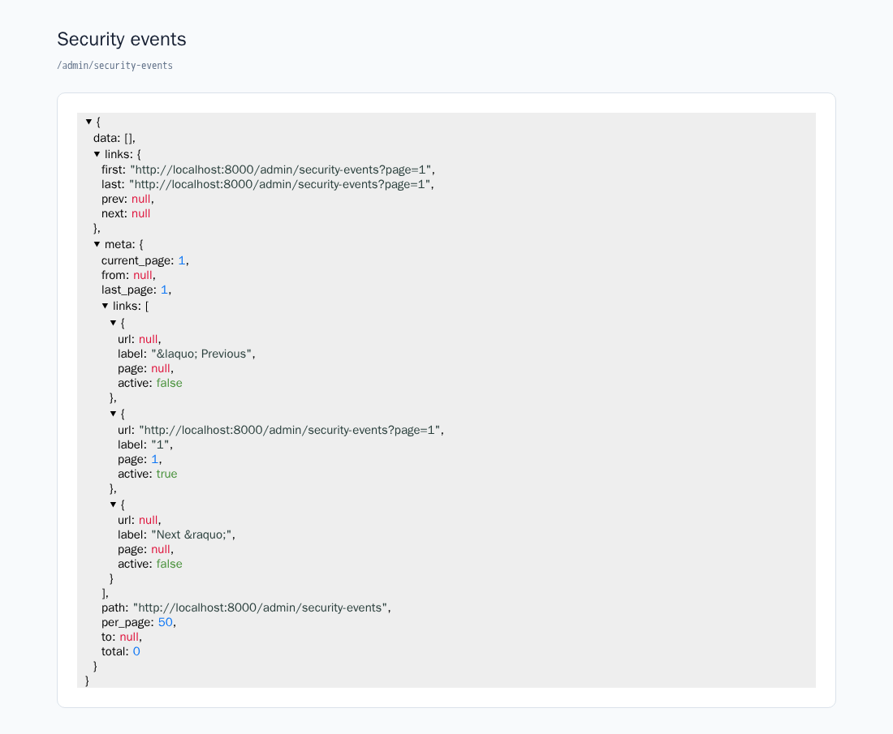

アカウントの重要な変更や、認証が拒否された操作をデータベースに記録します。利用者へ送る[アカウント変更通知](../security/#アカウント変更通知)とは別に、運用担当者が何が起きたかを調べるための機能です。

## 記録対象のイベント

イベントは `security` というログ名で保存します。結果は `success`（成功）と `failure`（失敗）で区別します。

### 成功した操作

| イベント名 | 記録する操作 |
| --- | --- |
| `email.changed` | メールアドレスの変更 |
| `password.changed` | 設定画面からのパスワード変更 |
| `password.reset` | パスワードリセットの完了 |
| `mfa.enabled` | 二要素認証の有効化 |
| `mfa.disabled` | 二要素認証の解除 |
| `mfa.recovery_codes.regenerated` | リカバリーコードの生成・再生成 |
| `passkey.created` | パスキーの追加 |
| `passkey.deleted` | パスキーの削除 |
| `account.deleted` | アカウントの削除 |

二要素認証の有効化に確認コードが必要な構成では、コードの確認が完了した時点で `mfa.enabled` を記録します。`mfa.disabled` の `properties.was_active` は、解除前に有効化済みだったかを示します。

### 拒否された操作

| イベント名 | 記録する失敗 |
| --- | --- |
| `login.failed` | メールアドレスとパスワードによるログインの失敗 |
| `mfa.failed` | ログイン時の二要素認証コード・リカバリーコードの不一致 |
| `email.change_failed` | メール変更時の現在のパスワードの検証失敗 |
| `password.change_failed` | パスワード変更時の現在のパスワードの検証失敗 |
| `password.reset_failed` | パスワードリセット処理でのトークン不正などによる拒否 |
| `account.delete_failed` | アカウント削除時のパスワードの検証失敗 |

すべてのHTTPエラーを記録するものではありません。たとえば、新しいパスワードの確認入力が一致しないだけの場合や、[レート制限](../security/#レート制限)で処理前に拒否されたリクエストは、上記の認証失敗とは区別されます。セッション失効や、パスキー認証の失敗を記録するイベントも、この実装にはありません。

### 保存する情報

イベント名、結果、対象ユーザーID、操作したユーザーID、記録日時と、イベントに応じた追加情報を保存します。対象や操作ユーザーを特定できない場合、IDは `null` になります。たとえば、未登録のメールアドレスによるログイン失敗では対象ユーザーを設定しません。

追加情報には、パスキーのID（`passkey_id`）、二要素認証の方式（`method`: `totp` または `recovery_code`）、リセット失敗の理由（`reason`）などが入ります。アカウント削除では、削除したユーザーのIDを `properties.user_id` に残します。

パスワード、認証コード、リセットトークン、入力されたメールアドレスやパスキー名などの生の入力値は、この記録処理に渡しません。IPアドレスやUser-Agentも、このログには自動で追加されません。

記録に失敗した場合は例外を報告し、元の操作は継続します。ログがないことだけを根拠に、操作がなかったとは判断できません。

## 閲覧権限と JSON エンドポイント

### 閲覧できるユーザーを設定する

`.env` の `AUDIT_SECURITY_VIEWERS` に、閲覧を許可するユーザーのメールアドレスをカンマ区切りで設定します。

```dotenv
AUDIT_SECURITY_VIEWERS=test@example.com
```

設定をキャッシュしている環境では、変更後に再生成します。

```sh
php artisan config:cache
```

閲覧には、ログイン済みであること、メールアドレスの確認が済んでいること、許可リストに含まれることが必要です。メールアドレスの比較では大文字・小文字を区別しません。許可リストが空の場合は、誰も閲覧できません。

:::caution[メールアドレス確認が必要です]
閲覧権限は、確認済みのメールアドレスで判定します。導入時にメールアドレス確認機能を除外し、ユーザーモデルが `MustVerifyEmail` を実装していない場合も、閲覧は許可されません。
:::

判定は `app/Providers/AppServiceProvider.php` の `view-security-events` Gateにまとめています。ロールによる権限管理に変更する場合は、このGateを変更します。

### JSONを取得する

許可されたユーザーでログインし、`/admin/security-events` を開きます。このエンドポイントは閲覧専用のJSONを返します。専用の管理画面や、APIトークンによる認証は用意していません。

:::note[表示や加工は利用側で用意します]
返るのは無加工のJSONです。見やすい一覧、検索フォーム、JSONの整形表示などが必要な場合は、用途に合わせて実装してください。以下の表示例も、このキットに標準搭載された管理画面ではありません。
:::

この環境では、メール確認済みの `test@example.com` に閲覧を許可してログインし、HTTP `200` でJSONが返ることを確認しました。撮影時点のイベントは0件のため、`data` は空配列、`meta.total` は `0` です。

<figure>



<figcaption>閲覧を許可したユーザーで取得したセキュリティイベントのJSON</figcaption>
</figure>

```text
GET /admin/security-events
GET /admin/security-events?result=failure
GET /admin/security-events?event=password.changed
GET /admin/security-events?result=failure&event=login.failed&page=2
```

結果は新しいID順で、1ページ50件です。`result` は `success` または `failure`、`event` はイベント名の完全一致で絞り込みます。`event` は100文字以内です。フィルターは併用できます。

レスポンスの `data` にイベントの配列、`links` と `meta` にページ送りの情報が入ります。各イベントは次の項目を持ちます。

| 項目 | 内容 |
| --- | --- |
| `id` | ログのID |
| `event` | イベント名 |
| `result` | `success` または `failure` |
| `subject_id` | 対象ユーザーのID。特定できない場合などは `null` |
| `causer_id` | 操作したユーザーのID。未認証の操作などは `null` |
| `properties` | 結果とイベント固有の追加情報 |
| `created_at` | 記録日時（ISO 8601形式） |

ログイン済みでも閲覧権限がなければHTTP `403` になります。このエンドポイントへの追加・更新・削除リクエストは受け付けません。

:::note[表示の加工は利用側で用意します]
返されるのは生のJSONなので、見やすく整形したり管理画面として表示したりする処理は、利用側で用意してください。以下は加工した表示の一例です。

<figure>



<figcaption><a href="https://github.com/anyroad/react-json-view-lite">react-json-view-lite</a> による整形表示の実装例（標準の管理画面ではありません）</figcaption>
</figure>
:::

## 保持期間と削除

### 保持期間を設定する

セキュリティイベントの保持期間は、既定で **365日** です。`.env` で変更できます。

```dotenv
AUDIT_SECURITY_RETENTION_DAYS=365
```

`config/audit.php` の `retention_days.security` に反映されます。設定をキャッシュしている場合は、変更後に `php artisan config:cache` を実行してください。

日数には1以上の整数を指定します。不正な値の場合、そのログの定期削除は登録せず、設定エラーを報告します。`0` を「即時削除」の意味では使えません。

### 定期削除を動かす

`routes/console.php` で、保持期間を過ぎたログを削除する処理を1日1回実行するよう登録しています。実際に定期実行するには、運用環境でLaravelのスケジューラーを動かす必要があります。設定を書くだけでは削除されません。

たとえば、サーバーのcronから毎分スケジューラーを呼び出します。パスは配置先に合わせて変更してください。

```text
* * * * * cd /path/to/app && php artisan schedule:run >> /dev/null 2>&1
```

登録された処理は `php artisan schedule:list` で確認できます。ローカルで継続実行する場合は `php artisan schedule:work` を使えます。

### 手動で削除する

次のコマンドは、`security` ログのうち記録日時が365日より前のレコードを削除します。削除操作なので、対象ログ名と日数を確認して実行してください。

```sh
php artisan activitylog:clean security --days=365
```

本番環境で実行確認を省略する場合は `--force` を付けます。定期実行では、設定したログ名と日数に加えて `--force` を指定しています。手動実行の `--days` は、指定した値で削除範囲を決めるため、設定した保持期間より短くもできる点に注意してください。

:::note[変更・削除の保護範囲]
`App\Models\Activity` は、セキュリティイベントのモデル経由の更新・削除を禁止しています。ただし、保持期間に基づく一括削除は意図的に許可しています。直接のSQLやモデルイベントを通さない一括更新・削除まで防ぐ仕組みではありません。
:::
