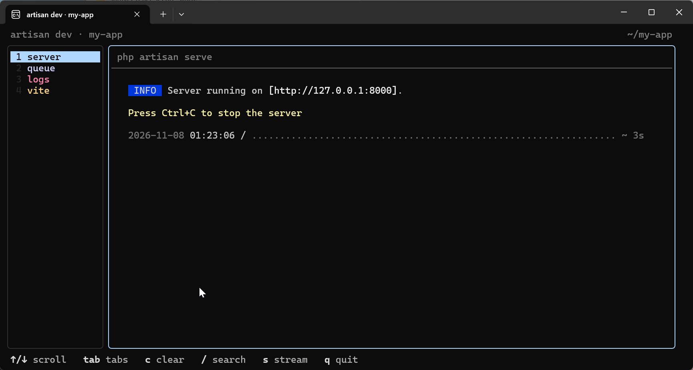
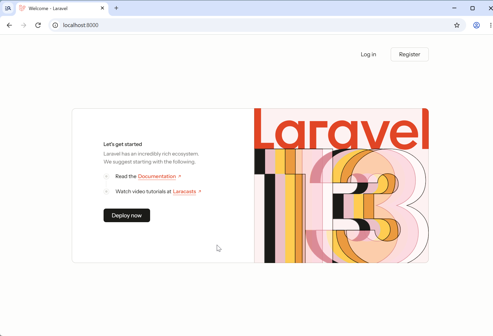
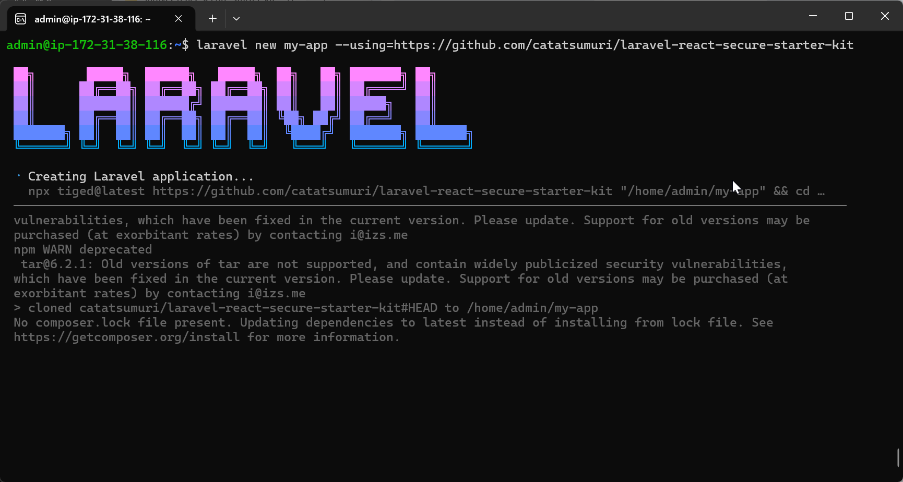

[システム要件](../)を準備できたら、Laravel Installer でアプリを作成します。この手順では SQLite を使い、Laravel Boost の導入は省略します。

Debian の ARM64 環境（EC2 `t4g.small`）で、PHP 8.4.27・Node.js 24.22.2・npm 11.19.1 を使い、作成から初期画面の表示まで確認しています。

## 1. 必要なツールを確認する

```sh
php --version
composer --version
node --version
npm --version
```

Node.js と npm は、**`laravel new` の実行前に必要**です。GitHub からキットを取得するときにも `npx` を使います。インストール方法はここでは省略します。

Debian の検証環境では、次のパッケージを用意しました。

```sh
sudo apt install composer git php-xml php-bcmath php-sqlite3
```

`php-xml`・`php-bcmath` は Composer の依存関係の導入に、`php-sqlite3` は SQLite のマイグレーションに必要でした。

## 2. Laravel Installer を入れる

```sh
composer global require laravel/installer
export PATH="$PATH:$(composer global config bin-dir --absolute)"
laravel --version
```

`export` は、Composer がインストールしたコマンドを今のターミナルから使えるようにします。次回のログイン後も使う場合は、同じ行を `~/.bashrc` など、使用しているシェルの設定ファイルへ追加してください。

## 3. アプリを作成する

プロジェクトを置きたいディレクトリで実行します。`my-app` は作成するディレクトリ名です。まだ存在しない名前を指定してください。

```sh
laravel new my-app \
  --using=https://github.com/catatsumuri/laravel-react-secure-starter-kit \
  --no-boost
```

`--using` で、このキットの GitHub URL を指定します。Installer は `tiged` でファイルを取得し、Composer の依存関係をインストールします。`--no-boost` は、任意機能の Laravel Boost の導入を省略する指定です。

まずは `--no-boost` でアプリの導入・起動を確認し、AI 支援機能が必要になったら Boost を後から追加する流れをおすすめします。

検証では Boost を含めた導入も完了しています。一度だけ Installer 内の Boost 初期化で失敗しましたが、手動での再実行と、その後の新規インストールでは成功しました。原因は未特定です。

## 4. 認証機能を選ぶ

途中で、次の選択画面が表示されます。

```text
Which authentication features would you like to enable?

  Email verification
  Registration
  Two-factor authentication
  Passkeys
  Password confirmation
```

スペースキーで選択を切り替え、Enter で確定します。まず一通り試す場合は、すべて有効にしたまま進めてください。

| 項目 | 機能 |
| --- | --- |
| Email verification | メールアドレスの確認 |
| Registration | 新規ユーザー登録 |
| Two-factor authentication | 二要素認証 |
| Passkeys | パスキー認証 |
| Password confirmation | 重要な操作の前のパスワード再確認 |

この選択に応じて、Chisel が不要な機能のコードや設定を取り除きます。**Password confirmation を外すと、ブラウザー用のセッション管理画面も除去されます。**

選択後は、Wayfinder の生成、データベースのマイグレーション、テスト環境の設定、npm パッケージの導入とアセットのビルドが進みます。今回の実行では Pest が設定されました。

`Application ready` と表示されたら、作成完了です。

## 5. 開発サーバーを起動する

```sh
cd my-app
composer run dev
```

開発サーバー、キューワーカー、ログ表示、Vite をまとめて起動します。ターミナルでは、それぞれのタブを切り替えて状態を確認できます。



このコマンドは**実行中のターミナルを使い続けます**。起動したまま別のコマンドを実行したいときは、別のターミナルを開いてください。SSH 接続なら、もう1本接続を開きます。終了は `Ctrl+C` です。

## 6. ブラウザーで確認する

ブラウザーで <http://localhost:8000> を開きます。Welcome ページと、右上の **Log in / Register** が表示されれば、起動と初期画面の表示を確認できています。



ここまでで確認しているのは、アプリの起動と初期画面の表示です。登録・ログインや各セキュリティ機能の動作確認は、続けて行います。

<details>
<summary>EC2 など、SSH 接続先のアプリを手元のブラウザーで開く場合</summary>

`localhost` は、そのブラウザーを動かしている PC を指します。リモートで開発サーバーを起動する場合は、手元の PC で SSH ポート転送を使うと、同じ URL で確認できます。

```sh
ssh -L 8000:127.0.0.1:8000 -L 5173:127.0.0.1:5173 admin@YOUR_SERVER
```

`YOUR_SERVER` は接続先へ置き換えてください。必要に応じて、普段の SSH 接続と同じ鍵ファイルの指定を加えます。8000 はアプリ、5173 は Vite の既定ポートです。転送用の接続は、ブラウザーで確認している間は開いたままにします。

</details>

## 任意：Laravel Boost を後から追加する

アプリの起動を確認したら、必要に応じて Boost を開発用の依存パッケージとして追加できます。プロジェクトのルート（`my-app`）で実行してください。開発サーバーが動いている場合は、別のターミナルを使えます。

```sh
composer require laravel/boost --dev
php artisan boost:install
```

`boost:install` の案内に従って、使用する AI エージェントを選択します。選択に応じたガイドラインや設定ファイルが生成されます。詳しくは [Laravel Boost の公式導入手順](https://laravel.com/framework/docs/boost#installation)を参照してください。

## 途中で止まった場合

<details>
<summary>Creating Laravel application で失敗する</summary>

`npm WARN exec` や `npm WARN deprecated` の表示だけで、取得に失敗したとは限りません。続くログを確認してください。



`cloned ... to .../my-app` と出ていれば、取得は済んでいます。その後の Composer の処理を確認します。

```sh
cd my-app
composer install
```

今回の検証では、ここで `ext-xml` の不足を確認しました。必要な拡張を追加してから再実行します。

</details>

<details>
<summary>マイグレーションで失敗する</summary>

SQLite を使う場合は、PHP の SQLite ドライバーを確認します。Debian の検証環境では、次の追加でマイグレーションが成功しました。

```sh
sudo apt install php-sqlite3
```

Installer の完了前にエラーが出ていた場合は、最後の `Application ready` だけで判断せず、プロジェクト内でマイグレーション結果も確認してください。

```sh
php artisan migrate
```

</details>
