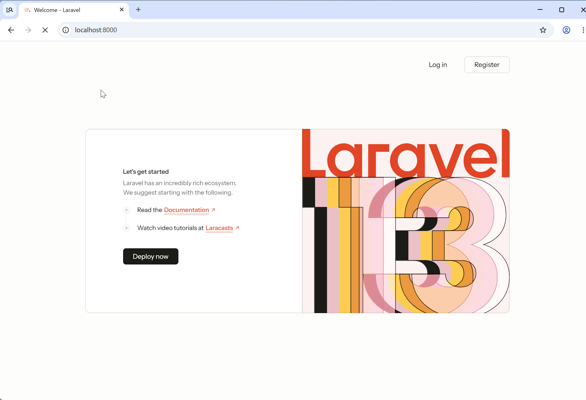
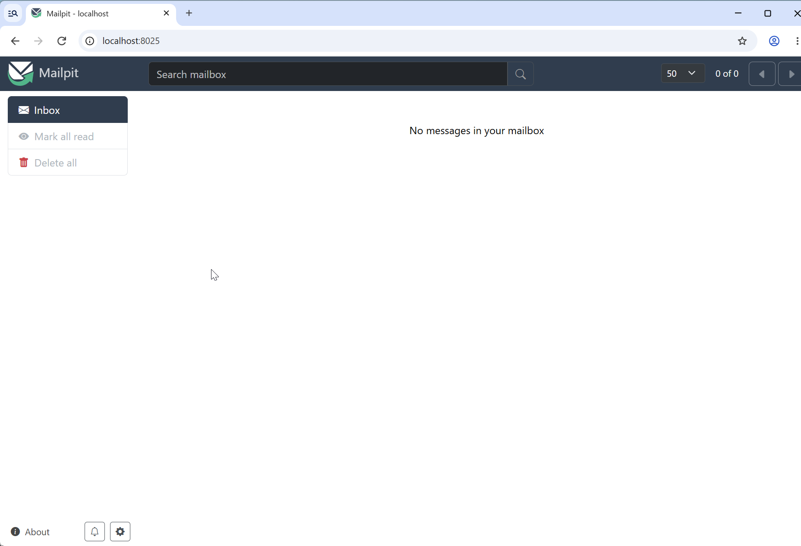

Docker 上で開発したい場合は Laravel Sail を使います。この手順では、**SQLite と Mailpit** を使う構成で進めます。

Debian の ARM64 環境（EC2 `t4g.small`）で、コンテナのビルド、アプリの初期画面、Mailpit の受信箱の表示まで確認しています。

## 1. 環境を準備する

Docker と Docker Compose を利用できる状態にしてください。この手順では、コンテナを用意するまでの処理に、ホスト側の Git・PHP・Composer・Node.js・npm も使います。[システム要件](../)も確認してください。

```sh
docker --version
docker compose version
```

## 2. キットを取得する

今回は GitHub から直接 clone します。`my-app` には、まだ存在しないディレクトリ名を指定してください。

```sh
git clone https://github.com/catatsumuri/laravel-react-secure-starter-kit.git my-app
cd my-app
cp .env.example .env
composer install --ignore-platform-reqs
```

`--ignore-platform-reqs` は、Sail の準備のためにホスト側の PHP バージョン・拡張のチェックを省略する指定です。コンテナ内での互換性を保証するものではなく、後でコンテナ側の要件を確認します。また、Composer のスクリプトはホストで実行されるため、その処理に必要なツールや拡張は必要です。

途中で Chisel による認証機能の選択が表示されます。スペースキーで選択を切り替え、Enter で確定します。初回の確認では、すべて有効にしたまま進められます。

```text
Which authentication features would you like to enable?

  Email verification
  Registration
  Two-factor authentication
  Passkeys
  Password confirmation
```

Password confirmation を外すと、ブラウザー用のセッション管理画面も除去されます。

## 3. Sail のサービスを選ぶ

```sh
php artisan sail:install
```

サービス選択画面では、既定で選ばれている **mysql の選択を外し、mailpit を選択**します。スペースキーで切り替え、Enter で確定してください。

- **データベース**：今回は DB サービスを追加せず、`.env` の `DB_CONNECTION=sqlite` を維持します。
- **Mailpit**：メール確認・パスワードリセット・変更通知など、開発中のメールを確認するために使います。

DB サービスを選ばないこと自体が、任意の設定を SQLite に変更するわけではありません。このキットの `.env.example` が SQLite を使うため、その設定をそのまま利用します。

初回は Mailpit のイメージ取得と、Sail のアプリ用イメージのビルドが進みます。PHP や Node.js などの準備が入るため、完了まで待ちます。

`Sail scaffolding installed successfully` と表示されたら、Sail の準備は完了です。

## 4. ポートを決めてコンテナを起動する

今回はブラウザーでポート8000を使うため、`.env` に次の設定を追加・確認します。

```dotenv
APP_PORT=8000
APP_URL=http://localhost:8000
```

`APP_PORT` は PC 側でアプリにアクセスするポートです。省略時は80番を使います。Vite のポートとは別です。

ターミナル1でコンテナを起動します。

```sh
./vendor/bin/sail up
```

このターミナルは起動用として残します。別のターミナル（SSH の場合は別接続）を開き、同じ `my-app` ディレクトリで次の作業を進めてください。

ポートを変更した場合など、コンテナをバックグラウンドで作成・起動するには `./vendor/bin/sail up -d` を使えます。

## 5. アプリキーとデータベースを準備する

ここからは Sail を通じて、コンテナ内でコマンドを実行します。

```sh
./vendor/bin/sail composer check-platform-reqs
./vendor/bin/sail artisan key:generate
./vendor/bin/sail artisan migrate --seed
```

最初のコマンドで、コンテナ側の PHP と拡張が依存パッケージの要件を満たすことを確認します。不足があれば、先へ進む前にコンテナの環境を調整してください。マイグレーションで SQLite ファイルの作成を尋ねられたら、作成を選択します。

<details>
<summary>検証用 DB を削除して作り直す場合</summary>

今回の検証では、次のコマンドで DB を初期化しました。**既存テーブルとデータを削除するため、破棄できる検証用 DB にだけ使用してください。**

```sh
./vendor/bin/sail artisan migrate:fresh --seed --force
```

</details>

## 6. Vite+ を起動する

ターミナル2で実行します。

```sh
./vendor/bin/sail npm run dev
```

コンテナ内の Node.js で Vite+ が起動します。`Inertia SSR dev endpoint: /__inertia_ssr` は起動時の案内です。このターミナルも実行中は開いたままにします。

## 7. アプリと Mailpit を開く

| 表示先 | URL |
| --- | --- |
| アプリ | <http://localhost:8000> |
| Mailpit | <http://localhost:8025> |

アプリで Welcome ページと **Log in / Register** が表示されることを確認します。



Mailpit を選ぶと、Sail が `.env` のメール設定を次のように変更します。

```dotenv
MAIL_MAILER=smtp
MAIL_HOST=mailpit
MAIL_PORT=1025
```

8025 はブラウザーで受信箱を見るためのポートです。アプリからのメール送信先は、コンテナ間で接続する `mailpit:1025` です。



初期状態の受信箱は空です。ここまでで確認できているのは Mailpit の画面表示までで、メール受信そのものは、メール確認やパスワードリセットなどを実行して別途確認します。

<details>
<summary>SSH 接続先を手元のブラウザーで開く場合</summary>

手元の PC から、アプリ・Vite・Mailpit のポートを転送できます。

```sh
ssh -L 8000:127.0.0.1:8000 -L 5173:127.0.0.1:5173 -L 8025:127.0.0.1:8025 admin@YOUR_SERVER
```

接続先と、必要に応じて鍵ファイルの指定を、普段の SSH 接続に合わせてください。転送用の接続はブラウザーを使う間は開いたままにします。

</details>

## 任意：Pest を使う

直接 clone したプロジェクトは、既定で PHPUnit を使います。Pest に切り替える場合は、コンテナが動いている状態で、プロジェクトのルートから手動で導入します。

```sh
./vendor/bin/sail composer remove phpunit/phpunit --dev
./vendor/bin/sail composer require pestphp/pest --dev --with-all-dependencies
./vendor/bin/sail pest --init
```

`phpunit/phpunit` はこのキットの開発用依存にあるため、削除にも `--dev` を付けます。初期化の案内に従って設定してください。

### 既存テストを Pest 形式へ変換する

既存の PHPUnit テストも Pest 形式に揃える場合は、Drift プラグインを追加して変換します。`--drift` は `tests/` 内のファイルを書き換えるため、変換後の差分を確認してください。

```sh
./vendor/bin/sail composer require pestphp/pest-plugin-drift --dev
./vendor/bin/sail pest --drift
```

今回の検証では、次のように25ファイルの変換完了が表示されました。件数は選択した機能やキットのバージョンによって変わります。

```text
INFO  The [tests] directory has been migrated to PEST with 25 files changed.
```

### テストを実行する

変換完了はテスト成功を意味しません。続けてテストを実行し、結果を確認します。

```sh
./vendor/bin/sail pest
```

詳しくは [Pest の公式導入手順](https://pestphp.com/docs/installation)と [PHPUnit からの移行ガイド](https://pestphp.com/docs/migrating-from-phpunit-guide)を参照してください。

## 任意：Laravel Boost を追加する

この手順では `laravel new` を使わないため、Boost は必要に応じて手動で追加します。コンテナが動いている状態で、プロジェクトのルートから実行してください。

```sh
./vendor/bin/sail composer require laravel/boost --dev
./vendor/bin/sail artisan boost:install
```

画面の案内に従って、使用する AI エージェントを選択します。

## 開発を終了する

Vite+ のターミナルは `Ctrl+C` で終了できます。コンテナを停止するには、プロジェクトのルートで次を実行します。

```sh
./vendor/bin/sail down
```
