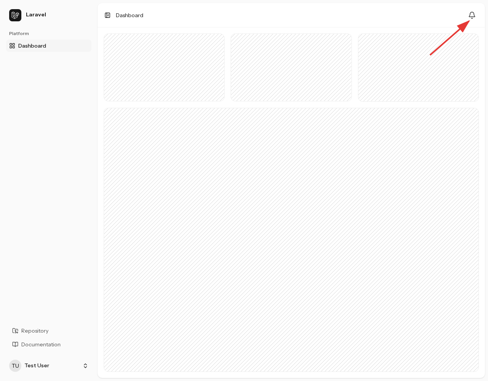
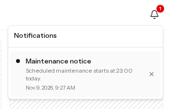
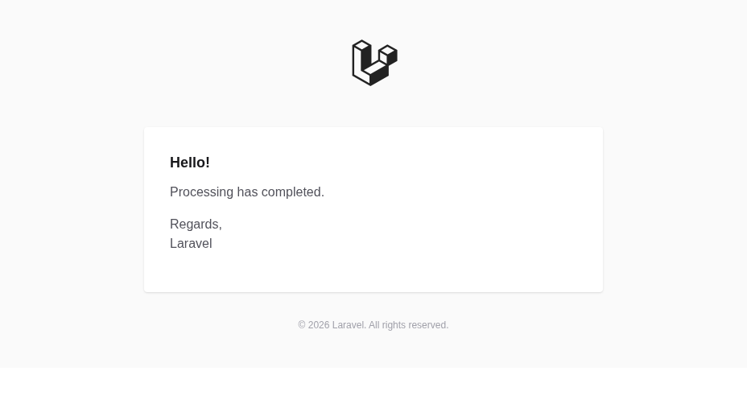

ユーザー向けのアプリ内通知と、運用者向けのメール・Slack配信が用意されています。

<figure>



<figcaption>ユーザー向けのアプリ内通知</figcaption>
</figure>

共通の `GeneralNotification` にタイトル、本文、任意の遷移先URLを渡して送信します。

[アカウント変更通知](../security/#アカウント変更通知)も同じ通知クラスを使いますが、送信先は対象ユーザーです。運用アラートの共通宛先とは別に扱います。

## アプリ内・メール・Slack の配信

| 配信先 | 用途 |
| --- | --- |
| `database` | ユーザーの通知をデータベースに保存し、ベルアイコンから表示します。ユーザー通知の既定値です。 |
| `mail` | ユーザーのメールアドレス、または運用者の共通宛先へ送信します。 |
| `slack` | 運用者用のWebhook URLへ送信します。送信時に明示的な指定が必要です。 |

### アプリ内通知

:::note[マイグレーションが未実行の場合]
`php artisan migrate` を実行して、`notifications` テーブルを用意してください。
:::

通知がある場合は最新10件を表示し、通知部分は15秒間隔で更新されます。未読件数は保存されている未読通知全体の件数で、100件以上の場合は「`99+`」と表示します。

通知を選択すると既読になり、遷移先URLがあればそのページへ移動します。右側の×ボタンで削除できます。既読への変更と削除は、自分の通知だけに対して実行できます。

### メールとSlackの設定

運用アラートの宛先を `.env` で設定します。

```dotenv
ALERT_MAIL_TO=ops@example.com
ALERT_SLACK_WEBHOOK_URL=https://hooks.slack.com/services/your/webhook/url
```

`ALERT_SLACK_WEBHOOK_URL` が未定義の場合は `LOG_SLACK_WEBHOOK_URL` を使います。`.env.example` には空の `ALERT_SLACK_WEBHOOK_URL` があるため、代替設定を使う場合はその行を削除してください。

メールには `MAIL_MAILER` や `MAIL_HOST` など、利用するサービスの送信設定も必要です。初期設定の `MAIL_MAILER=log` は本文をログへ出力するため、メールボックスには届きません。

設定をキャッシュしている環境では、変更後に更新します。

```sh
php artisan config:cache
```

:::note[Slackは明示的に指定します]
Webhook URLを設定するだけではSlackへ送信されません。運用者向け通知の既定の配信先と、例外・ジョブ失敗の自動アラートはメールのみです。
:::

## 通知の送信と拡張

### CLIからユーザーへ送信する

ユーザーIDまたは登録済みメールアドレスを指定します。次の例は `test@example.com` のアプリ内通知に保存されます。

```sh
php artisan notifications:send test@example.com \
  --title="Maintenance notice" \
  --body="Scheduled maintenance starts at 23:00 today." \
  --url=/dashboard
```

<figure>



<figcaption>CLIから送信したユーザー向けのアプリ内通知</figcaption>
</figure>

タイトルと本文を省略すると対話形式で入力します。遷移先URLは省略できます。対話入力なしで実行する場合は `--no-interaction` と必要なオプションを指定してください。

ユーザー向けのCLI送信は `database` のみです。`--channel` は `--alert` 用で、ユーザーへのメール送信には使いません。

### CLIから運用者へ送信する

メールのみを送る例です。

```sh
php artisan notifications:send --alert \
  --title="Operations notice" \
  --body="Processing has completed." \
  --no-interaction
```

<figure>



<figcaption>CLIから送信した運用通知のメール本文</figcaption>
</figure>

メールとSlackの両方へ送る場合は、配信先をそれぞれ指定します。Slackだけの場合は `--channel=slack` とします。

```sh
php artisan notifications:send --alert \
  --channel=mail --channel=slack \
  --title="運用通知" \
  --body="処理が完了しました。" \
  --no-interaction
```

指定した配信先のうち、宛先が設定されているものだけに送信します。送信可能な宛先がない場合や、`mail`・`slack` 以外を指定した場合はコマンドが失敗します。成功時には送信した配信先が表示されます。

### アプリケーションから送信する

`SendGeneralNotification` にユーザーと配信先を指定します。配信先の省略時は `database` のみです。

```php
use App\Actions\Notifications\SendGeneralNotification;

app(SendGeneralNotification::class)->handle(
    user: $user,
    title: 'メンテナンスのお知らせ',
    body: '本日23時からメンテナンスを行います。',
    actionUrl: '/dashboard',
    channels: ['database', 'mail'],
);
```

遷移先URLには `/dashboard` のようなアプリ内の相対パス、または `https://` のURLを指定できます。`http://` や `//example.com` などは拒否されます。メールでは遷移先をボタンとして表示し、Slackではタイトルと本文を表示します。

通常は呼び出し時に同期送信します。`deferred: true` を指定するとレスポンス後に配信し、配信エラーは報告して呼び出し元へ投げ直しません。登録ユーザーに紐づかないメールアドレスへは `toEmailAddress()`、運用者の共通宛先へは `toAlertRecipients()` を使えます。

`GeneralNotification` は `ShouldQueue` を実装していないため、この通知の送信自体にキューワーカーは不要です。レスポンス後の配信も、キューによる再試行や配送保証を提供するものではありません。独自の形式や再試行が必要な場合は、通知クラスや送信処理を拡張してください。

## 例外・ジョブ失敗のアラート

Laravelの例外報告処理と、キューの `JobFailed` イベントから `SendThrowableAlert` を呼び出します。例外報告の対象となったエラーと、失敗が確定したジョブの例外がメールアラートの対象です。通常の入力エラーなど、Laravelが報告対象にしない例外をすべて通知する仕組みではありません。

| 項目 | 内容 |
| --- | --- |
| 宛先 | `ALERT_MAIL_TO` |
| 件名 | `[アプリケーション名] 例外クラス名` |
| 本文 | 例外メッセージを500文字で打ち切ったもの（省略記号を付加） |
| 重複抑制 | 例外クラス・発生ファイル・行番号が同じものを5分間抑制 |

例外メッセージが違っていても、クラス・ファイル・行番号が同じなら同じ重複抑制枠を使います。判定には既定のキャッシュストアを使うため、複数のアプリケーションインスタンスで抑制を共有するには、共通のキャッシュを使ってください。キャッシュが利用できない場合は、抑制せず送信を試みます。

配信に失敗した場合は `Failed to send alert notification.` を警告ログに記録します。自動再送は行いません。重複抑制の枠は送信前に確保するため、送信に失敗した場合も同じ例外の後続アラートが5分間抑制されることがあります。

### テスト用の例外アラート

次のコマンドで、自動アラートと同じ送信処理・重複抑制を確認できます。

```sh
php artisan notifications:send --exception --body="運用アラートの送信確認"
```

同じコマンドを5分以内に繰り返すと重複として抑制されます。確認時に抑制を外す場合は `--no-throttle` を付けます。

```sh
php artisan notifications:send --exception --no-throttle \
  --body="運用アラートの送信確認"
```

`--exception` は `SendThrowableAlert` を直接呼び出すテストです。実際にHTTPリクエストやジョブを失敗させるものではありません。宛先未設定・重複抑制・配信失敗のいずれかで送信されなかった場合は、コマンドが失敗します。`--channel=slack` を付けても、このモードの配信先はメールのみです。

例外メッセージはアラート本文に入ります。送信先へ渡してよい情報になるよう、アプリケーション側で例外に含める内容を調整してください。
