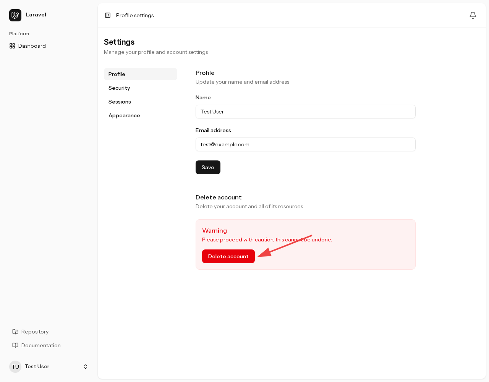
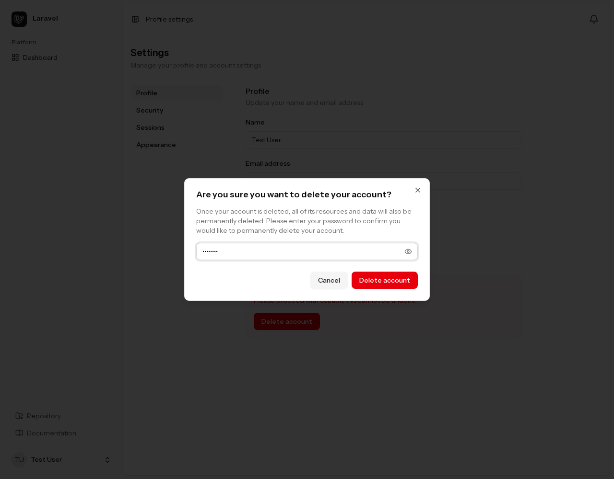
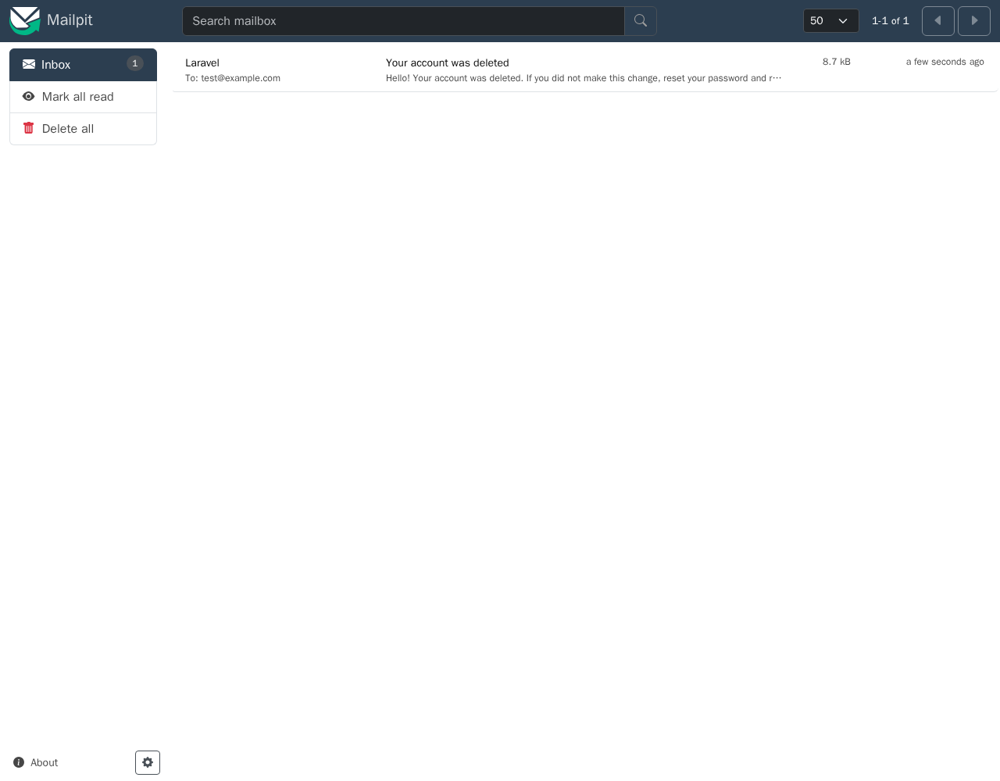
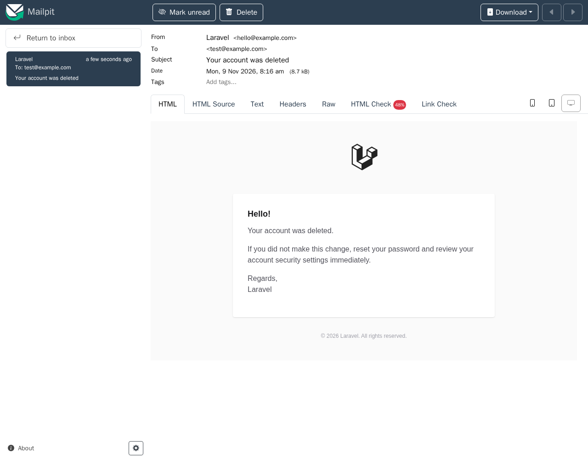
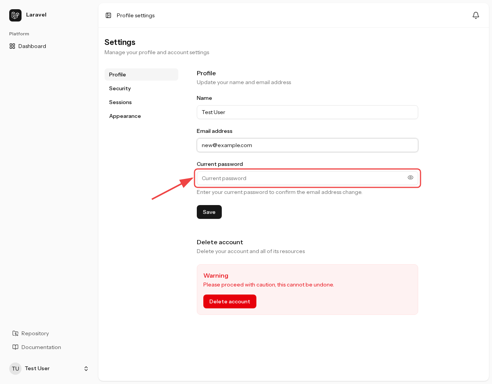
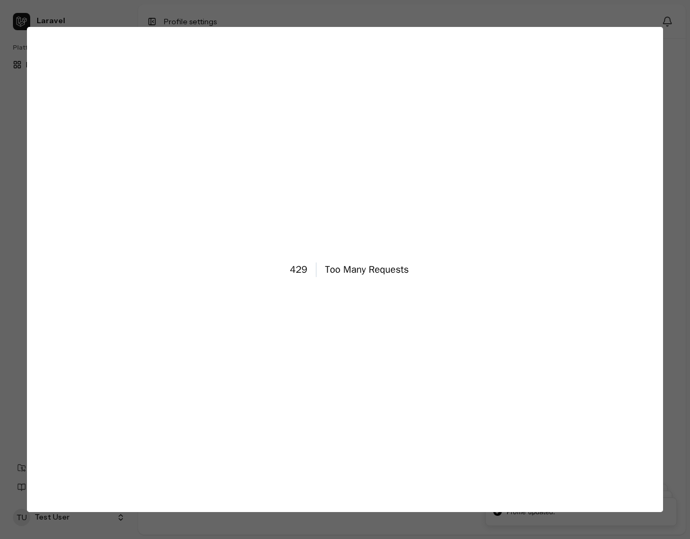

## アカウント変更通知

アカウントの認証情報やセキュリティ設定を変更すると、本人にメールで通知します。身に覚えのない変更に気づけるようにするための機能です。変更を承認するための確認メールではなく、操作が完了したことを知らせます。

### 通知される操作

| 操作 | 通知先 |
| --- | --- |
| メールアドレスの変更 | **変更前のメールアドレス** |
| パスワードの変更 | 登録中のメールアドレス |
| パスワードリセットの完了 | 登録中のメールアドレス |
| 二要素認証の有効化・無効化 | 登録中のメールアドレス |
| リカバリーコードの再生成 | 登録中のメールアドレス |
| パスキーの追加・削除 | 登録中のメールアドレス |
| アカウントの削除 | **削除時点のメールアドレス** |

メールアドレスの変更は、変更前のアドレスに通知します。変更後のアドレスを操作した本人だけが受信できる場合でも、元の所有者が変更に気づけるようにするためです。名前だけの変更は通知対象に含まれません。

二要素認証で確認コードの入力が必要な構成では、コードの確認が完了して認証が有効になった時点で通知します。設定を開始しただけでは、有効化の通知は送信しません。導入時に [Chisel](https://github.com/laravel/chisel) で除外した機能に関する操作・通知は利用できません。

### 通知の内容と配信

メールには変更内容と、身に覚えがない場合は速やかにパスワードをリセットし、アカウントのセキュリティ設定を確認するよう案内を記載します。

これらの通知はメールで配信され、アプリ内通知や Slack には配信されません。メールを受信できるよう、利用環境に合わせてメール送信設定を行ってください。

配信処理は操作へのレスポンスを返した後に実行されます。メール送信に失敗しても、完了した変更や削除は取り消されません。送信時の例外はアプリケーションの例外報告処理に渡されます。

### アカウント削除時の通知を確認する

プロフィール設定（`/settings/profile`）を開き、画面下部の「Delete account」ボタンを確認します。

<figure>

<figcaption>プロフィール設定画面。「Delete account」ボタンを赤い矢印で示している</figcaption>
</figure>

「Delete account」を押すと確認ダイアログが開きます。現在のパスワードを入力します。

<figure>

<figcaption>アカウント削除の確認ダイアログ。現在のパスワードを入力した状態</figcaption>
</figure>

確認ダイアログの「Delete account」を押して削除を確定します。削除が完了するとログアウトし、トップページへ戻ります。

Mailpit（<http://localhost:8025>）を開き、削除時点のメールアドレス宛てに「Your account was deleted」が届いていることを確認します。

<figure>

<figcaption>Mailpitの受信箱に届いたアカウント削除通知「Your account was deleted」</figcaption>
</figure>

メールを開き、本文にアカウントが削除されたことが記載されていることを確認します。

<figure>

<figcaption>アカウント削除通知の本文</figcaption>
</figure>

## メール変更時の本人確認

メールアドレスの変更には、現在のパスワードによる本人確認が必要です。ログイン済みでも、変更時にパスワードを入力します。名前だけを変更する場合は不要です。

:::note[メール変更時に本人確認が必要な理由]
セッションが盗まれたり、ログインしたままの端末を第三者に操作されたりすると、本人以外でもログイン状態を利用できる場合があります。メールアドレスを攻撃者のものに変更されると、パスワードリセットのメールも攻撃者に届き、アカウントを乗っ取られるおそれがあります。

変更時に現在のパスワードを再入力させることで、ログイン状態だけを手に入れた第三者によるメールアドレス変更を防ぎます。
:::

プロフィール設定（`/settings/profile`）を開き、「Email address」を変更します。変更すると「Current password」欄と、メールアドレス変更の確認のために現在のパスワードを入力する案内が表示されます。

<figure>

<figcaption>メールアドレスを変更すると表示される、本人確認用の「Current password」欄</figcaption>
</figure>

現在のパスワードを入力して「Save」を押します。サーバー側でもパスワードを検証し、入力がない場合や一致しない場合はメールアドレスを変更しません。

## レート制限

レート制限は、一定時間内に受け付けるリクエストの回数を制限する仕組みです。パスワードや確認コードの総当たり、短時間の大量操作を抑えるため、認証や設定変更に適用しています。

### 制限される操作

| 操作 | 上限 | 集計単位 |
| --- | --- | --- |
| メールアドレスとパスワードによるログイン | 1分間に5回 | メールアドレスとIPアドレスの組み合わせ |
| ログイン時の二要素認証 | 1分間に5回 | 認証中のユーザーID |
| プロフィールの保存・パスワードの変更 | 1分間に6回 | ログイン中のユーザー |
| パスワードリセットの送信（新しいパスワードの確定） | 1分間に10回、かつ同じメールアドレスでは5回 | IPアドレス単位で10回、メールアドレスとIPアドレスの組み合わせで5回 |
| メールアドレス確認リンクの利用・確認メールの再送 | 1分間に6回 | ログイン中のユーザー |
| セッションの失効 | 1分間に10回 | ユーザーIDとIPアドレスの組み合わせ |
| パスキーの認証・登録・削除など | 1分間に10回 | パスキーの資格情報ID（未指定時はセッションID）とIPアドレスの組み合わせ |

回数は失敗した操作だけでなく、制限対象のリクエストを受け付けた時点で数えます。たとえば、プロフィールの保存は名前だけの変更でも対象になります。導入時に除外した機能の操作は利用できません。

### 上限に達した場合

上限を超えると、そのリクエストは処理されず、HTTP `429 Too Many Requests` が返ります。制限が解除されるまで待ってから再操作してください。連打や自動再試行を続けても、その間の操作は受け付けられません。

プロフィール設定で、入力内容を変えずに「Save」を短時間に繰り返し押すと、制限に達した時点で次の画面が表示されます。

<figure>

<figcaption>プロフィール保存のレート制限に達したときの「429 Too Many Requests」画面</figcaption>
</figure>

### 設定を変更する場合

ログイン、二要素認証、パスワードリセット、セッション失効、パスキーの回数や集計単位は `app/Providers/FortifyServiceProvider.php` で定義しています。プロフィール保存とパスワード変更は `routes/settings.php` の `throttle:6,1`、メールアドレス確認は Fortify のルートに適用される制限です。

制限回数の記録にはキャッシュを使います。複数のアプリケーションサーバーで運用する場合は、同じ制限回数を共有できるキャッシュストアを使用してください。
