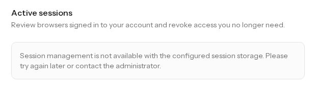
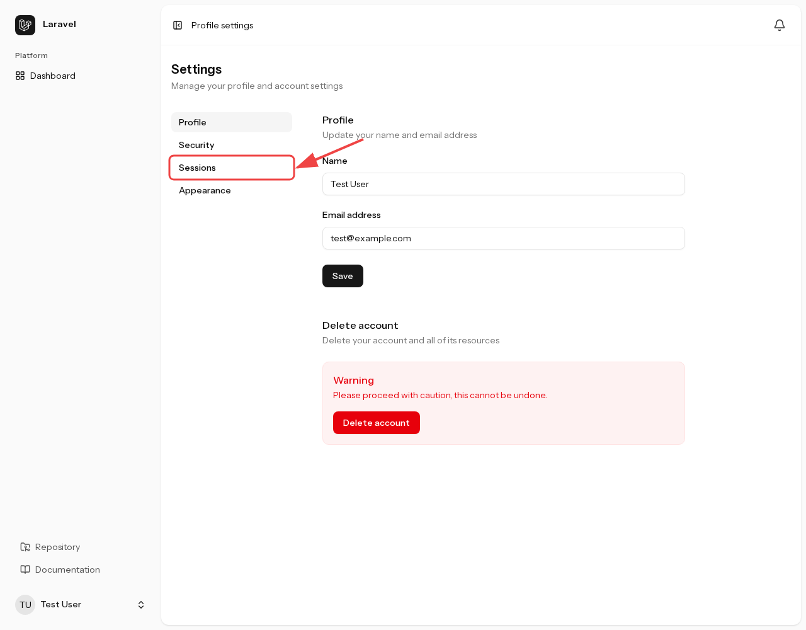
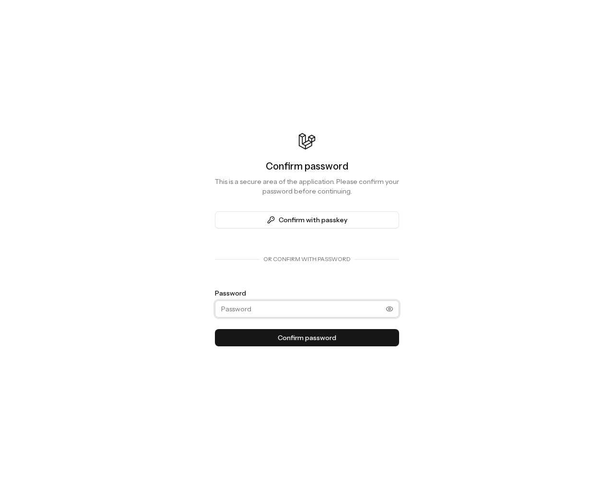
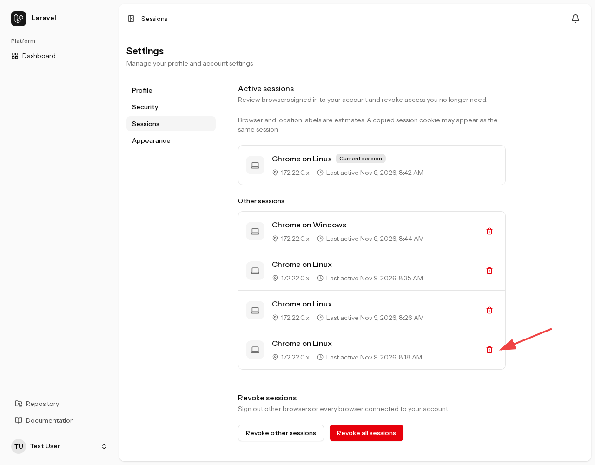
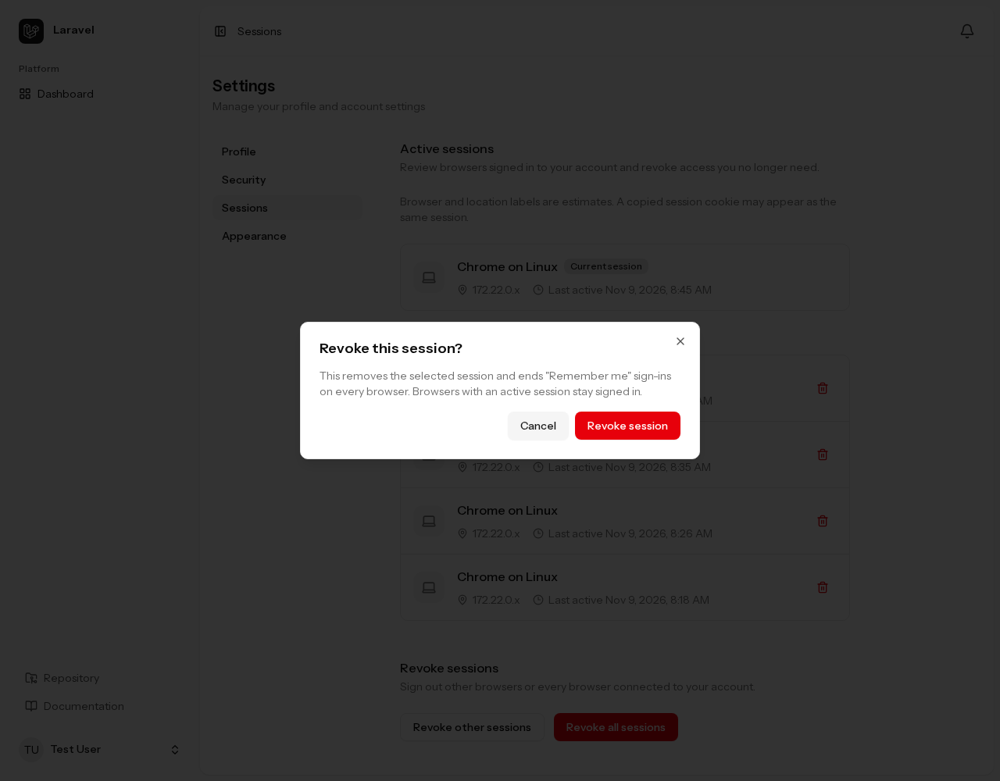
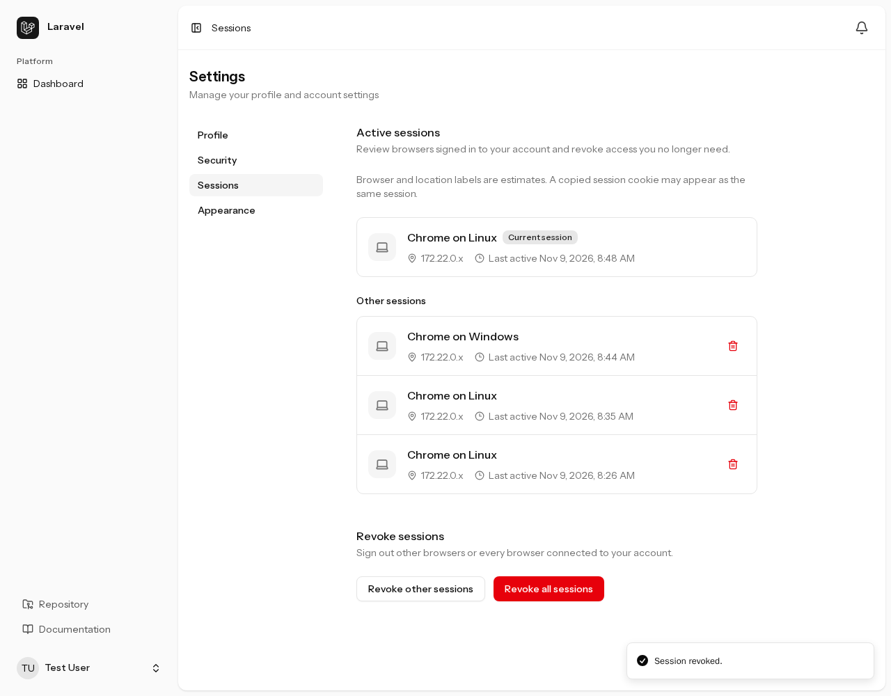
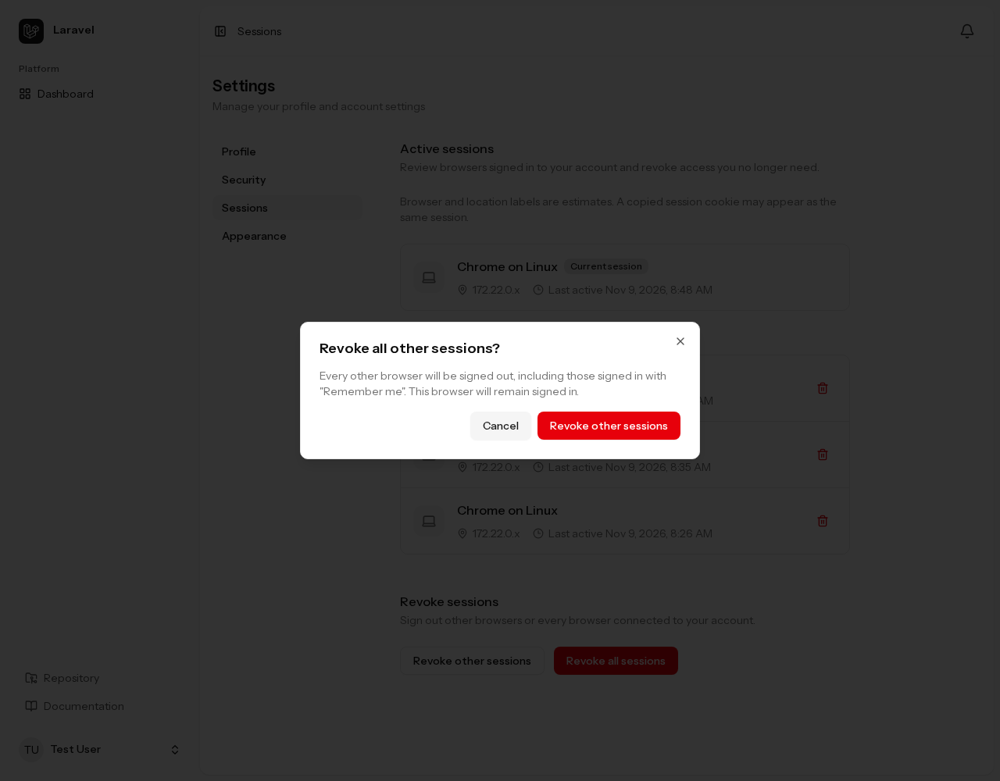
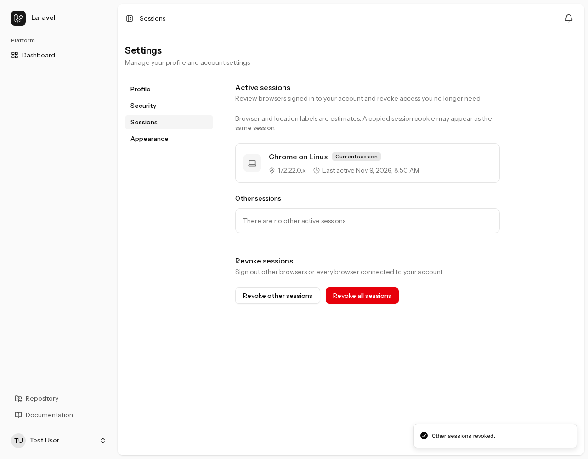
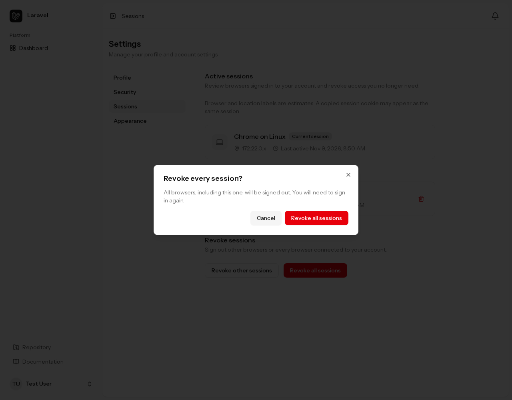
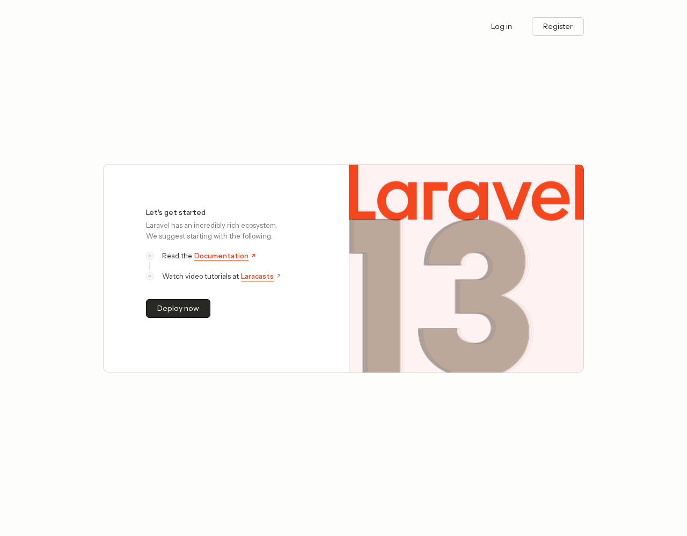

## database ドライバーの要件

このキットのセッション一覧・失効（revoke）機能を使うには、`.env` でセッションの保存先を `database` に設定する必要があります。初期設定は `database` です。

セッションの失効とは、保存されているログイン状態を無効にし、そのセッションでのアクセスを終了させることです。このキットでは、データベースのセッションテーブルからユーザーのログイン状態を取得し、対象のレコードを削除して失効させます。

:::caution[Redis・Memcachedなどでは、このキットの失効機能は使えません]
`SESSION_DRIVER=redis`、`memcached`、`file`、`cookie` などでも、それぞれの保存先に必要な設定を行えばアプリは利用できます。ただし、このキットのセッション一覧・失効機能は `database` 専用です。ほかのドライバーのセッションを探して削除する処理は実装していません。

対象には、設定画面での個別失効・ほかのセッションの一括失効・全セッションの失効と、運用者向けの失効コマンドが含まれます。
:::

`database` 以外の場合、セッション管理画面には利用できない旨が表示され、失効操作は利用できません。運用者向けコマンドも、ドライバーの要件を満たさないことを示して終了します。

`SESSION_DRIVER=file` に切り替えて再ログインし、セッション管理画面（`/settings/sessions`）を開くと、次のように利用できない旨が表示されます。セッション一覧や失効ボタンは表示されません。

<figure>



<figcaption>fileドライバーではセッション管理を利用できない</figcaption>
</figure>

同じ設定で運用者向けコマンドを実行すると、次のメッセージを表示して終了コード `1` で終了します。セッションの失効は実行されません。

```sh
php artisan security:revoke-sessions email:test@example.com --force
```

```text
Session revocation requires the database session driver.
```

### セッション管理用データベースの準備

`.env` のセッションドライバーを `database` に設定します。

```dotenv
SESSION_DRIVER=database
```

セッションを保存するテーブルが必要です。このキットの初期マイグレーションには `sessions` テーブルが含まれているため、導入時のマイグレーションを実行してください。

```sh
php artisan migrate
```

標準ではアプリの既定のデータベース接続と `sessions` テーブルを使用します。接続やテーブル名を変更する場合は、`config/session.php` に対応する `SESSION_CONNECTION`・`SESSION_TABLE` を設定し、指定先にセッションテーブルを用意してください。

設定をキャッシュしている環境では、`.env` の変更後に設定キャッシュを再生成します。

```sh
php artisan config:cache
```

セッションドライバーを切り替えても、以前の保存先のセッションは移行されません。既存の利用者は再ログインが必要になります。このキットの失効操作も、以前の保存先に残ったセッションを削除するものではありません。

## 設定画面での一覧と失効

プロフィール設定（`/settings/profile`）を開き、設定メニューの「`Sessions`」を押してセッション管理へ進みます。

<figure>



<figcaption>プロフィール設定の「<code>Sessions</code>」からセッション管理へ進む</figcaption>
</figure>

### セッション管理を開く前の本人確認

セッション管理画面（`/settings/sessions`）を開くには、ログインに加えてパスワード確認（Password confirmation）が必要です。「`Password`」に現在のパスワードを入力し、「`Confirm password`」を押すと、セッション管理画面へ進みます。パスキーを登録している場合は「`Confirm with passkey`」でも本人確認できます。

<figure>



<figcaption>セッションの一覧・失効操作を保護するための本人確認画面</figcaption>
</figure>

ログイン状態を第三者に利用された場合でも、セッション情報の閲覧や、本人が利用中の別の端末をログアウトさせる操作を簡単に行えないようにするための確認です。

セッション管理では、本人確認の有効期間を **15分** に設定しています。直近15分以内に確認済みであれば毎回の入力は不要ですが、期限が切れると一覧の表示や失効操作の前に再確認を求められます。

導入時に [Chisel](https://github.com/laravel/chisel) で「`Password confirmation`」を除外すると、ブラウザー用のセッション管理画面も除去されます。

### ログイン中のセッションを確認する

本人確認が完了すると、「`Active sessions`」に現在のセッションと、ほかのログイン中のセッションが表示されます。現在操作中のセッションには「`Current session`」が付き、ほかのセッションは「`Other sessions`」に並びます。

<figure>



<figcaption>現在のセッションと、ほかのログイン中のセッションの一覧</figcaption>
</figure>

各セッションでは、ブラウザーとOS、マスクされたIPアドレス、最終アクセス日時を確認できます。ブラウザーやOSの表示は推定です。コピーされたセッションCookieによるアクセスは、同じセッションとして表示される場合があります。

ここから、赤い矢印で示したゴミ箱アイコンを使って、そのセッションを1件失効させてみます。

### セッションを1件失効させる

対象のゴミ箱アイコンを押すと、「`Revoke this session?`」という確認ダイアログが開きます。

<figure>



<figcaption>選択したセッションを失効させる前の確認</figcaption>
</figure>

この操作では、選択したセッションの削除に加え、すべてのブラウザーの「`Remember me`」による自動ログインも無効にします。ほかの有効なセッションはログイン状態を維持します。

本人確認の有効期間内であれば、このダイアログでパスワードを再入力する必要はありません。「`Revoke session`」を押して失効を確定します。

<figure>



<figcaption>選択したセッションの失効後。ほかのセッションは3件になった</figcaption>
</figure>

「`Session revoked.`」と表示され、対象のセッションが一覧から消えたことを確認します。現在操作しているセッションはそのまま利用できます。

### ほかのセッションをまとめて失効させる

「`Revoke other sessions`」を押すと、「`Revoke all other sessions?`」という確認ダイアログが開きます。

<figure>



<figcaption>ほかのセッションをまとめて失効させる前の確認</figcaption>
</figure>

ダイアログの「`Revoke other sessions`」を押して確定します。現在操作中のセッションを残し、ほかのセッションをすべて失効させます。「`Remember me`」による自動ログインも無効になります。

<figure>



<figcaption>一括失効後。現在のセッションだけが残り、ほかのセッションは0件になった</figcaption>
</figure>

「`Other sessions revoked.`」と表示され、「`Other sessions`」が「`There are no other active sessions.`」になったことを確認します。このブラウザーでは、そのまま操作を続けられます。

### 現在のセッションも含めてすべて失効させる

「`Revoke all sessions`」を押すと、「`Revoke every session?`」という確認ダイアログが開きます。現在操作しているブラウザーもログアウトする操作です。

<figure>



<figcaption>現在のブラウザーも含め、全セッションを失効させる前の確認</figcaption>
</figure>

ダイアログの「`Revoke all sessions`」を押して確定します。すべてのセッションと「`Remember me`」による自動ログインが無効になり、このブラウザーもログアウトしてトップページへ戻ります。

<figure>



<figcaption>全セッション失効後。このブラウザーもログアウトしてトップページへ戻る</figcaption>
</figure>

セッション管理画面へ再度アクセスすると、ログイン画面に移動します。操作を続けるには再ログインが必要です。

## CLIでセッションを失効させる

サーバーのターミナルから `security:revoke-sessions` を実行すると、指定したユーザーのセッションをすべて失効させられます。アプリの実行環境とデータベースにアクセスできる運用者向けの操作です。`SESSION_DRIVER=database` が必要です。

ブラウザーでのパスワード確認はありません。対象の指定と実行確認はCLIで行います。以下のコマンドはプロジェクトのルートで実行してください。Sailを使う場合は `php artisan` を `./vendor/bin/sail artisan` に置き換えます。

### 対象を指定して実行する

メールアドレスには `email:`、ユーザーIDには `id:` を付けて指定します。次は、この環境の `test@example.com` を対象にした実行例です。

```sh
php artisan security:revoke-sessions email:test@example.com
```

実行すると、対象の名前・メールアドレス・IDと、保存されているセッション数を表示して確認を求めます。この例では、ID `1` のユーザーに1件のセッションがありました。

```text
Revoke 1 session(s) for Test User (test@example.com, ID 1)? (yes/no) [no]:
> yes

Revoked 1 session(s) for user ID 1.
```

表示された対象を確認し、`yes` を入力して確定します。初期値は `no` なので、そのままEnterを押した場合は失効せず、「`No sessions were revoked.`」 と表示して終了します。

同じユーザーをIDで指定する場合は、次のコマンドです。

```sh
php artisan security:revoke-sessions id:1
```

### 実行後の状態

指定ユーザーのセッションをすべて削除し、「`Remember me`」による自動ログインも無効にします。設定画面の「`Revoke other sessions`」と異なり、残すセッションは指定できません。対象ユーザーのブラウザーは、次に認証が必要なページへアクセスした際に再ログインを求められます。

この環境では、実行後にデータベースを確認し、対象ユーザーの保存済みセッション数・有効なセッション数がともに `0` 件になったことを確認しました。ブラウザーが開いている画面を、その場で強制的に閉じる操作ではありません。

CLIが表示する件数は、期限切れを含む保存済みレコードの数です。設定画面の一覧は有効期限内のセッションを対象にするため、件数が一致しない場合があります。保存済みセッションが0件でも、確認後に「`Remember me`」の自動ログインを無効にする処理を実行します。

### 確認を省略する場合

自動実行などで確認プロンプトを省略する場合は `--force` を付けます。

```sh
php artisan security:revoke-sessions email:test@example.com --force
```

`--force` は確認を省略するためのオプションです。ユーザーの指定形式や存在確認、セッションドライバーの要件は引き続き検証されます。

### エラー時の確認

ユーザーの指定が不正、対象が存在しない、ドライバーが `database` ではない、保存先にアクセスできない場合などは、エラーメッセージを表示して終了コード `1` で終了します。成功時と、確認で中止した場合の終了コードは `0` です。

「`Remember me`」の無効化後にセッション削除が失敗した場合は、その部分的な結果をメッセージで知らせます。エラー時は出力を確認し、原因を解消してから再実行してください。
