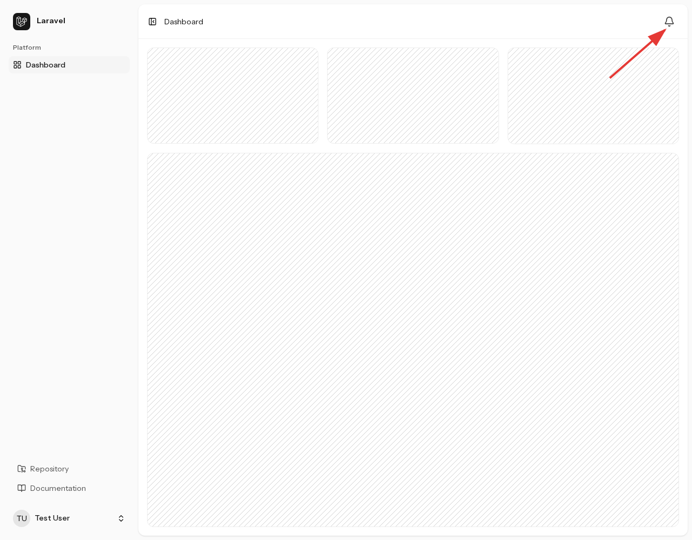
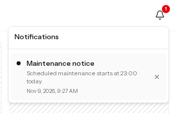
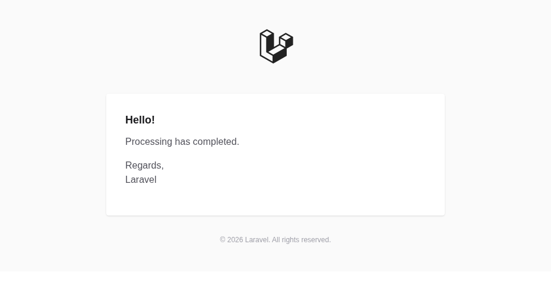

The kit provides in-app notifications for users and mail or Slack delivery for operators.

<figure>



<figcaption>In-app notifications for users</figcaption>
</figure>

The shared `GeneralNotification` accepts a title, body, and optional action URL.

[Account change notifications](../security/#account-change-notifications) use the same class, but are addressed to the affected user rather than the shared operator recipients.

## In-app, mail, and Slack delivery

| Channel | Purpose |
| --- | --- |
| `database` | Stores a user's notification for the bell menu. Default for user notifications. |
| `mail` | Sends to a user's email or the shared operator address. |
| `slack` | Sends to the operator webhook URL. Must be explicitly requested. |

### In-app notifications

:::note[If migrations have not run]
Run `php artisan migrate` to create the `notifications` table.
:::

The menu shows the latest 10 notifications and polls every 15 seconds. The badge counts all stored unread notifications and displays “`99+`” for 100 or more.

Selecting a notification marks it as read and follows its action URL if present. The × button deletes it. Users can mark as read or delete only their own notifications.

### Configuring mail and Slack

Set operator recipients in `.env`.

```dotenv
ALERT_MAIL_TO=ops@example.com
ALERT_SLACK_WEBHOOK_URL=https://hooks.slack.com/services/your/webhook/url
```

When `ALERT_SLACK_WEBHOOK_URL` is undefined, the configuration falls back to `LOG_SLACK_WEBHOOK_URL`. Because `.env.example` contains an empty `ALERT_SLACK_WEBHOOK_URL`, remove that line if you intend to use the fallback.

Mail also requires transport settings such as `MAIL_MAILER` and `MAIL_HOST`. The initial `MAIL_MAILER=log` configuration writes messages to the log instead of delivering them to a mailbox.

Rebuild cached configuration after changes.

```sh
php artisan config:cache
```

:::note[Slack is opt-in]
Setting the webhook URL alone does not enable Slack delivery. The default operator channel and the automatic exception and failed-job alerts use mail only.
:::

## Sending and extending notifications

### Sending to a user from the CLI

Specify a user ID or a registered email address. This example saves an in-app notification for `test@example.com`.

```sh
php artisan notifications:send test@example.com \
  --title="Maintenance notice" \
  --body="Scheduled maintenance starts at 23:00 today." \
  --url=/dashboard
```

<figure>



<figcaption>An in-app user notification sent from the CLI</figcaption>
</figure>

Omitting the title or body prompts for it interactively. The action URL is optional. For unattended use, pass `--no-interaction` and the required options.

User delivery from this CLI uses `database` only. `--channel` applies to `--alert`, not to sending email to a user.

### Sending to operators from the CLI

To send mail only:

```sh
php artisan notifications:send --alert \
  --title="Operations notice" \
  --body="Processing has completed." \
  --no-interaction
```

<figure>



<figcaption>The operator notification email body sent from the CLI</figcaption>
</figure>

Request both channels explicitly to send mail and Slack. Use only `--channel=slack` for Slack alone.

```sh
php artisan notifications:send --alert \
  --channel=mail --channel=slack \
  --title="Operations notice" \
  --body="Processing has completed." \
  --no-interaction
```

Only requested channels with configured recipients are used. The command fails if none are available or if a channel other than `mail` or `slack` is requested. Success output lists the channels used.

### Sending from application code

Pass the user and channels to `SendGeneralNotification`. The default channel is `database`.

```php
use App\Actions\Notifications\SendGeneralNotification;

app(SendGeneralNotification::class)->handle(
    user: $user,
    title: 'Maintenance notice',
    body: 'Scheduled maintenance starts at 23:00 today.',
    actionUrl: '/dashboard',
    channels: ['database', 'mail'],
);
```

Action URLs may be application-relative paths such as `/dashboard` or valid `https://` URLs. `http://` and protocol-relative URLs such as `//example.com` are rejected. Mail shows the action as a button; Slack shows the title and body.

Delivery is synchronous by default. Set `deferred: true` to deliver after the response and report delivery failures without rethrowing them to the caller. Use `toEmailAddress()` for an address without an associated user account, or `toAlertRecipients()` for shared operator recipients.

`GeneralNotification` does not implement `ShouldQueue`, so this notification itself does not require a queue worker. After-response delivery also provides no queue-based retry or delivery guarantee. Extend the notification class or delivery process for custom formats or retries.

## Exception and failed-job alerts

Laravel's exception reporting and the queue's `JobFailed` event call `SendThrowableAlert`. Reportable exceptions and exceptions from jobs whose failure has been finalized are eligible for email alerts. Exceptions Laravel does not report, such as ordinary validation errors, are not all turned into alerts.

| Item | Behavior |
| --- | --- |
| Recipient | `ALERT_MAIL_TO` |
| Subject | `[Application name] ExceptionClassName` |
| Body | Exception message limited to 500 characters, with an omission suffix when truncated |
| Duplicate suppression | Same exception class, file, and line suppressed for five minutes |

Different messages share a suppression slot if their class, file, and line match. The default cache store holds these slots. Use a shared cache for suppression across multiple application instances. If the cache is unavailable, delivery is attempted without suppression.

Delivery failures produce the warning `Failed to send alert notification.` in the log. There is no automatic retry. The suppression slot is claimed before delivery, so a failed delivery can also suppress subsequent alerts for five minutes.

### Testing exception alerts

This command exercises the same delivery and duplicate suppression used by automatic alerts.

```sh
php artisan notifications:send --exception --body="Operations alert delivery check"
```

Repeating it within five minutes is suppressed as a duplicate. Use `--no-throttle` to bypass suppression for testing.

```sh
php artisan notifications:send --exception --no-throttle \
  --body="Operations alert delivery check"
```

`--exception` directly calls `SendThrowableAlert`; it does not fail a real HTTP request or queued job. The command fails if no alert is sent because of missing recipients, suppression, or delivery failure. Even with `--channel=slack`, this mode uses mail only.

The exception message becomes the alert body. Ensure application exceptions contain only information appropriate for those recipients.
