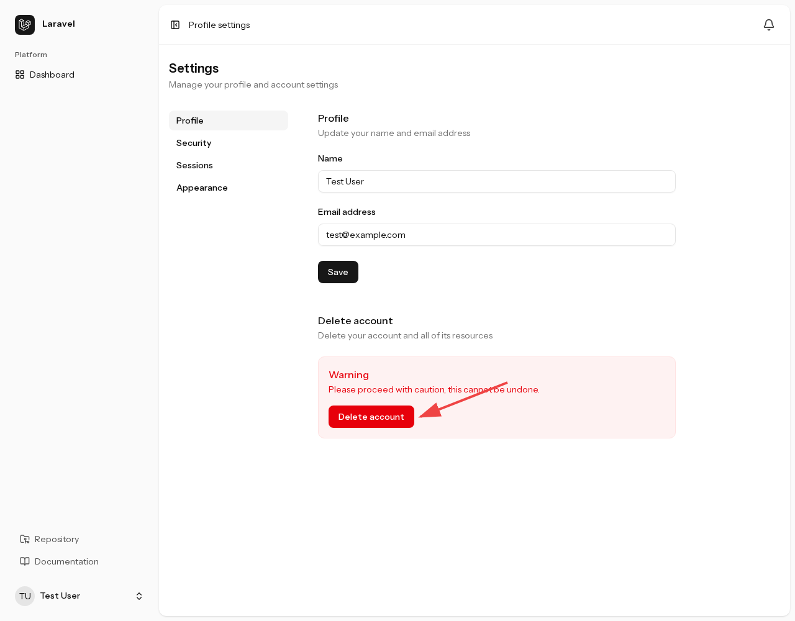
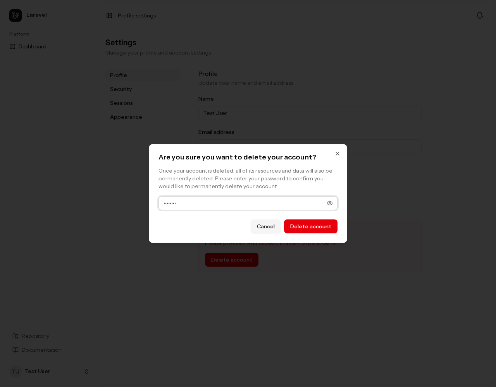
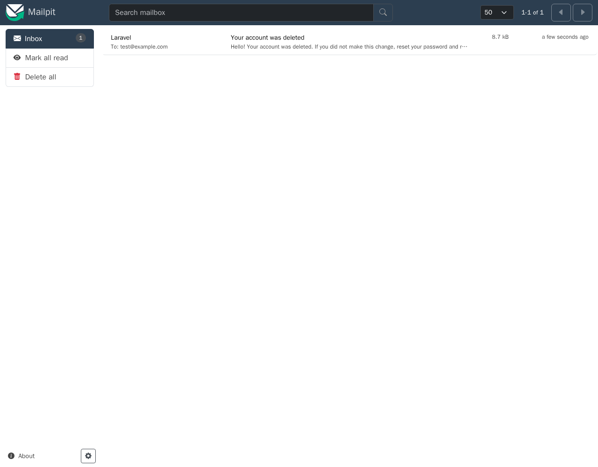
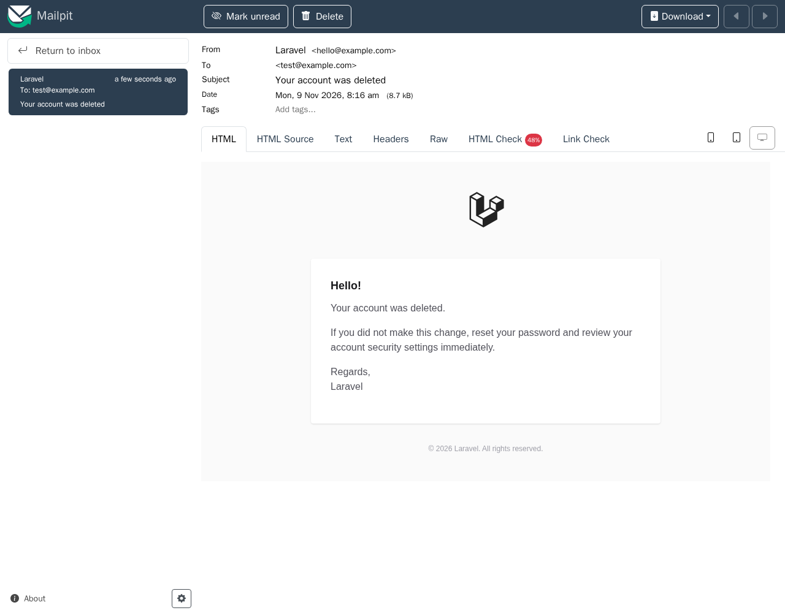
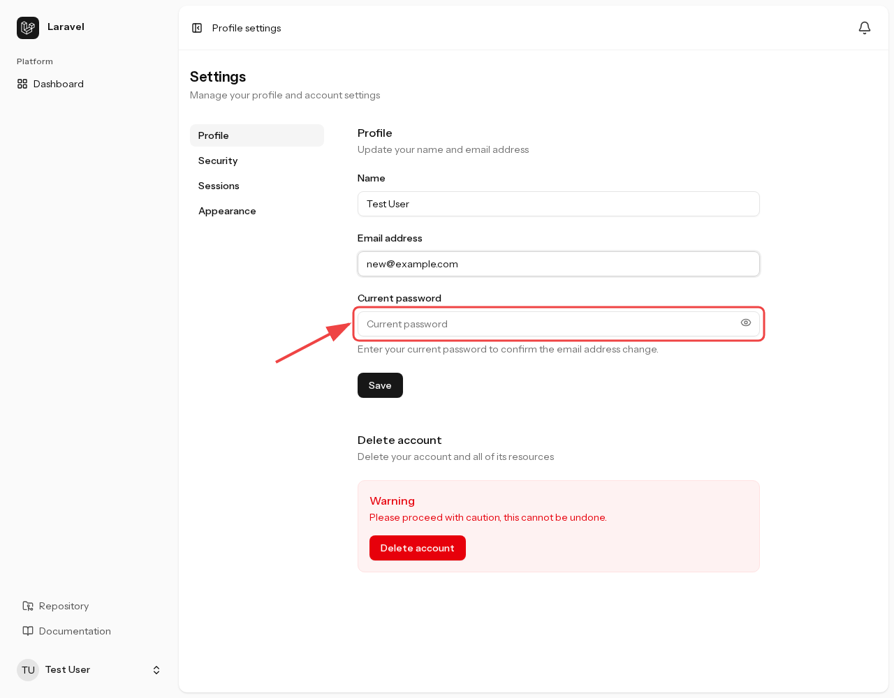
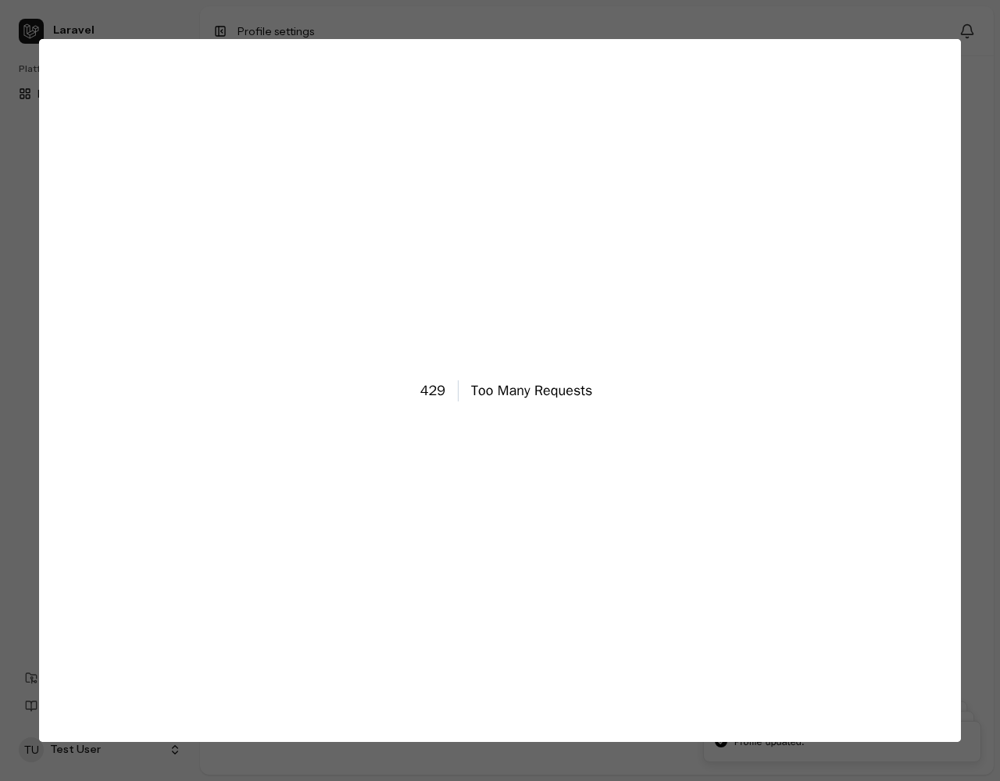

## Account change notifications

Changes to account credentials and security settings trigger an email to the account owner. These messages help users notice unexpected changes. They report completed operations; they are not approval requests.

### Operations that send notifications

| Operation | Recipient |
| --- | --- |
| Email address change | **Previous email address** |
| Password change | Current registered email address |
| Completed password reset | Current registered email address |
| Enabling or disabling two-factor authentication | Current registered email address |
| Regenerating recovery codes | Current registered email address |
| Adding or deleting a passkey | Current registered email address |
| Account deletion | **Email address at the time of deletion** |

Email changes notify the previous address so the original owner can notice the change even if someone else controls the new address. Name-only changes do not trigger a notification.

When two-factor authentication requires a confirmation code, the enable notification is sent only after confirmation succeeds. Starting setup alone does not send it. Operations and notifications for features excluded through [Chisel](https://github.com/laravel/chisel) are unavailable.

### Message contents and delivery

Messages describe the change and advise users who do not recognize it to reset their password promptly and review their account security settings.

These notifications use email only, not the in-app menu or Slack. Configure mail delivery for your environment.

Delivery runs after the response is sent. Mail failures do not undo completed changes or account deletion. Delivery exceptions are passed to the application's exception reporting.

### Checking the account deletion notification

Open profile settings at `/settings/profile` and find the “`Delete account`” button at the bottom.

<figure>

<figcaption>The “<code>Delete account</code>” button in profile settings</figcaption>
</figure>

Select “`Delete account`” to open the confirmation dialog and enter the current password.

<figure>

<figcaption>Account deletion confirmation with the current password entered</figcaption>
</figure>

Confirm with “`Delete account`”. Once deletion completes, the browser is signed out and returns to the application's home page.

Open Mailpit at <http://localhost:8025> and check that “`Your account was deleted`” was delivered to the address used at deletion.

<figure>

<figcaption>The “<code>Your account was deleted</code>” notification in Mailpit</figcaption>
</figure>

Open the message and confirm that its body reports the account deletion.

<figure>

<figcaption>The account deletion notification body</figcaption>
</figure>

## Password confirmation for email changes

Changing an email address requires the current password even when the user is signed in. Changing only the name does not require it.

:::note[Why email changes require confirmation]
A stolen session or an unattended signed-in device can let another person act as the user. If they change the email address to one they control, password reset messages can go to that address and enable an account takeover.

Requiring the current password for the change prevents someone who has obtained only the signed-in session from changing the email address.
:::

Open `/settings/profile` and change “`Email address`”. A “`Current password`” field appears with instructions to confirm the email change.

<figure>

<figcaption>The “<code>Current password</code>” field shown for an email change</figcaption>
</figure>

Enter the current password and select “`Save`”. The server validates the password and refuses the email change if it is missing or incorrect.

## Rate limits

Rate limits restrict the number of requests accepted in a time window. They help reduce password and confirmation-code guessing and repeated sensitive operations.

### Limited operations

| Operation | Limit | Scope |
| --- | --- | --- |
| Email and password login | 5 per minute | Email address and IP address |
| Two-factor login challenge | 5 per minute | User ID in the authentication flow |
| Profile saves and password changes | 6 per minute | Signed-in user |
| Password reset submission (setting the new password) | 10 per minute per IP, and 5 per email/IP pair | IP address and email/IP pair |
| Email verification links and resending verification mail | 6 per minute | Signed-in user |
| Session revocation | 10 per minute | User ID and IP address |
| Passkey authentication, registration, deletion, and related operations | 10 per minute | Credential ID (session ID if absent) and IP address |

Limited requests count when accepted by the limiter, not only when the operation fails. For example, saving only a name also counts as a profile save. Operations for excluded authentication features are unavailable.

### When the limit is reached

Requests beyond the limit are not processed and receive HTTP `429 Too Many Requests`. Wait for the limit to expire before trying again. Repeated clicks or automatic retries do not make the blocked operations run.

Repeatedly selecting “`Save`” in profile settings, even without changing the values, eventually produces this response.

<figure>

<figcaption>The “<code>429 Too Many Requests</code>” response after reaching the profile save limit</figcaption>
</figure>

### Changing the configuration

Login, two-factor authentication, password reset, session revocation, and passkey limits are defined in `app/Providers/FortifyServiceProvider.php`. Profile saves and password changes use `throttle:6,1` in `routes/settings.php`. Email verification uses limits on Fortify's routes.

Counters use the cache. Use a shared cache store when multiple application servers must share the same limits.
