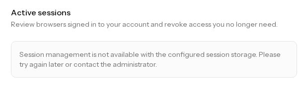
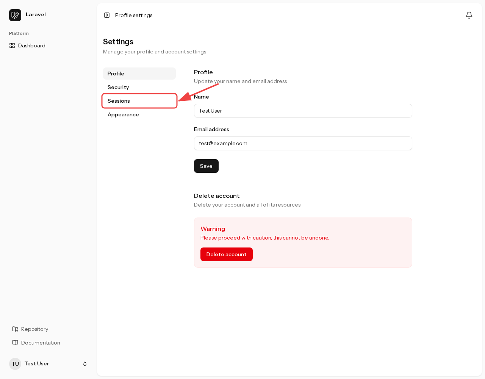
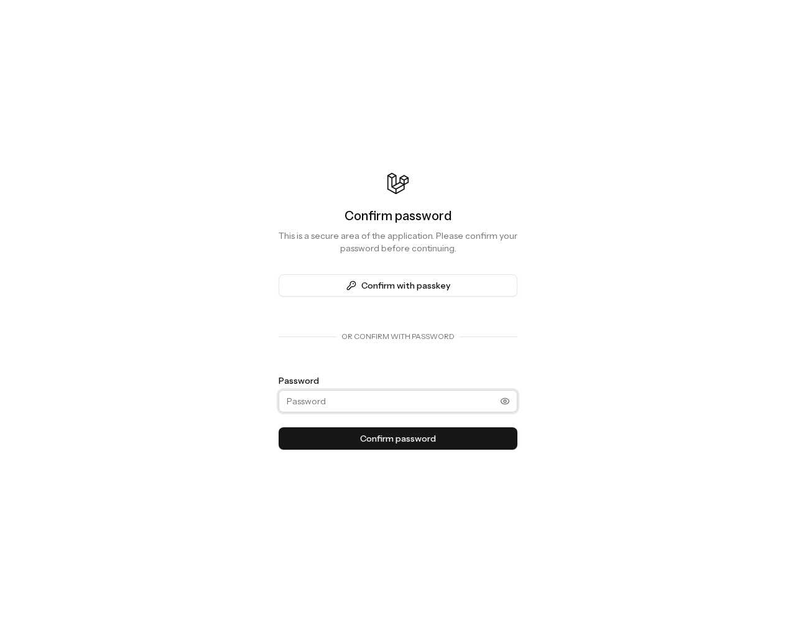
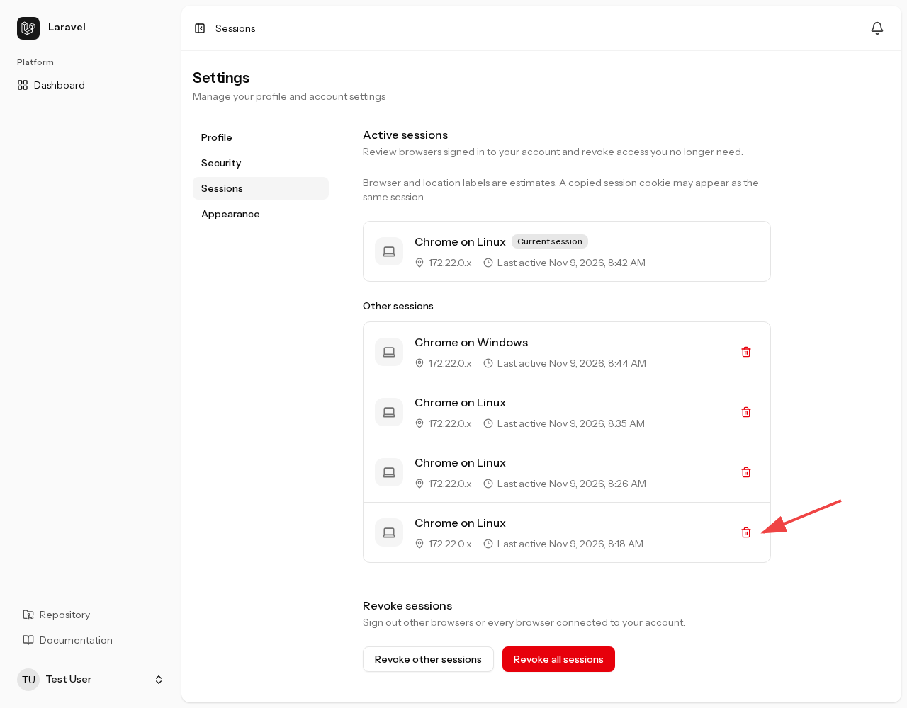
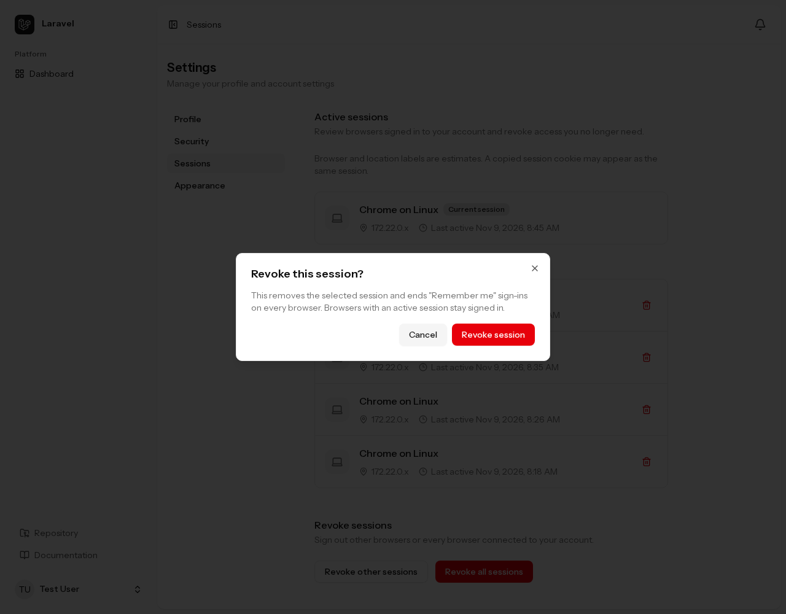
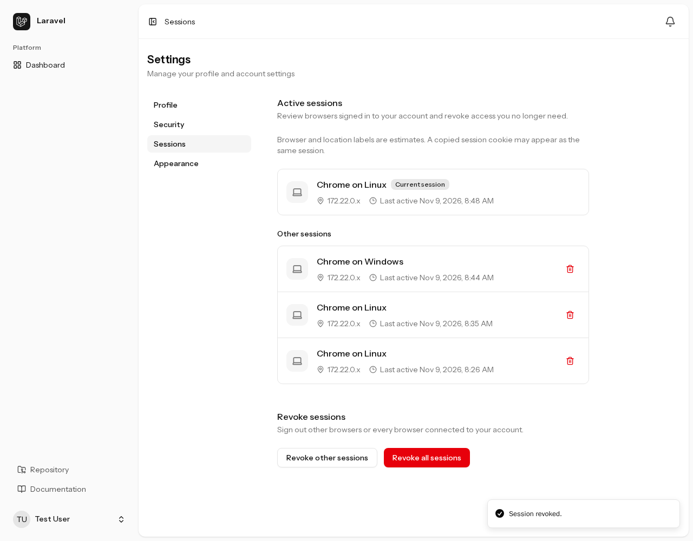
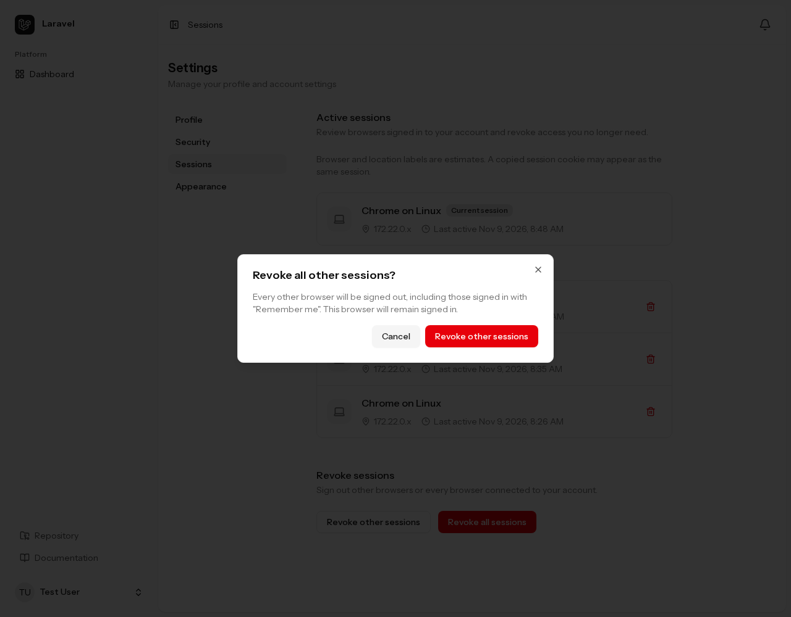
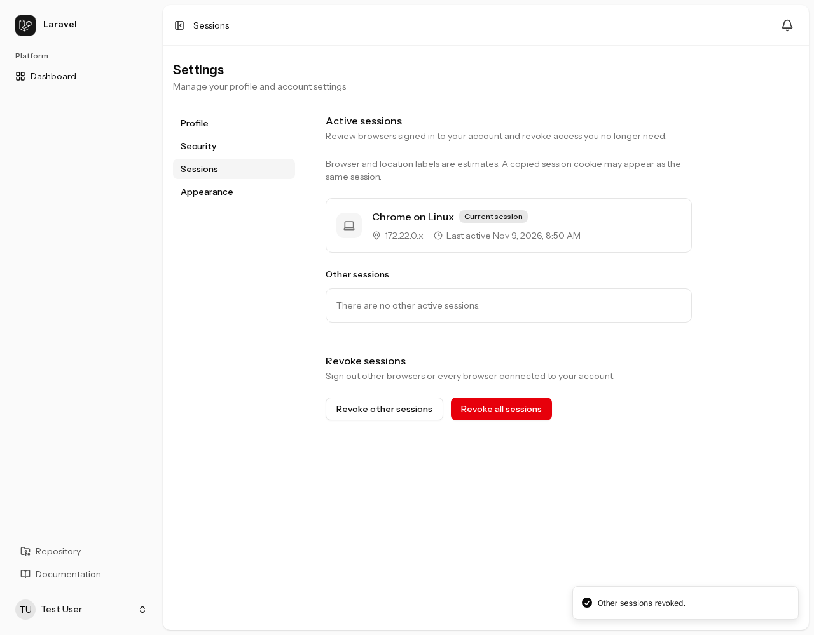
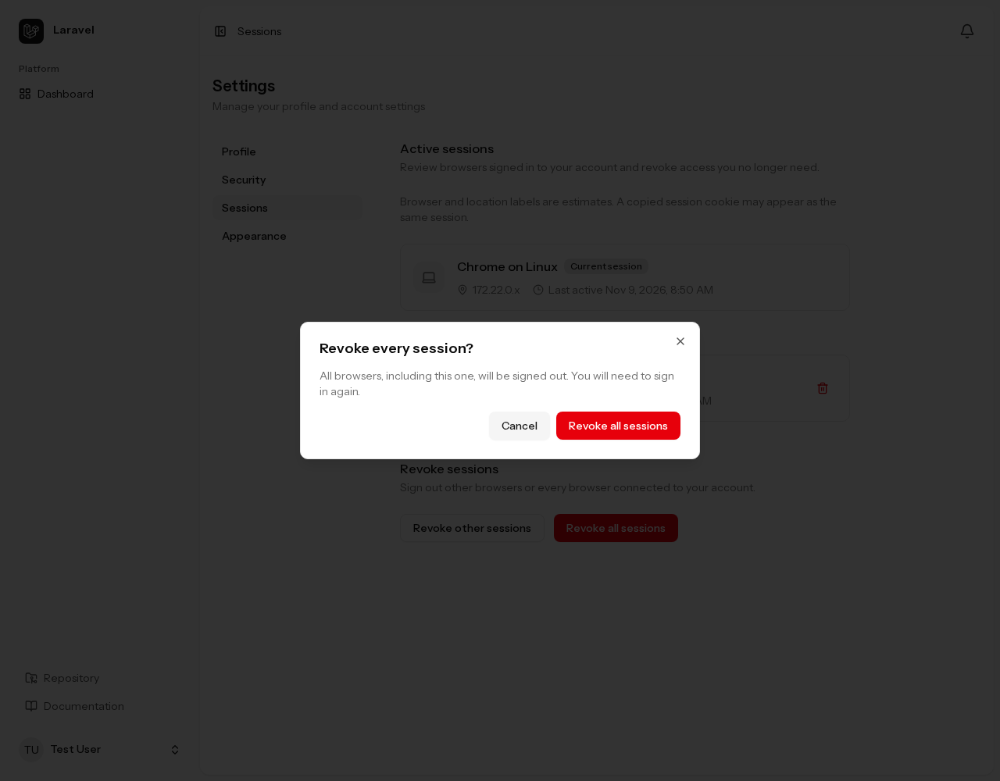
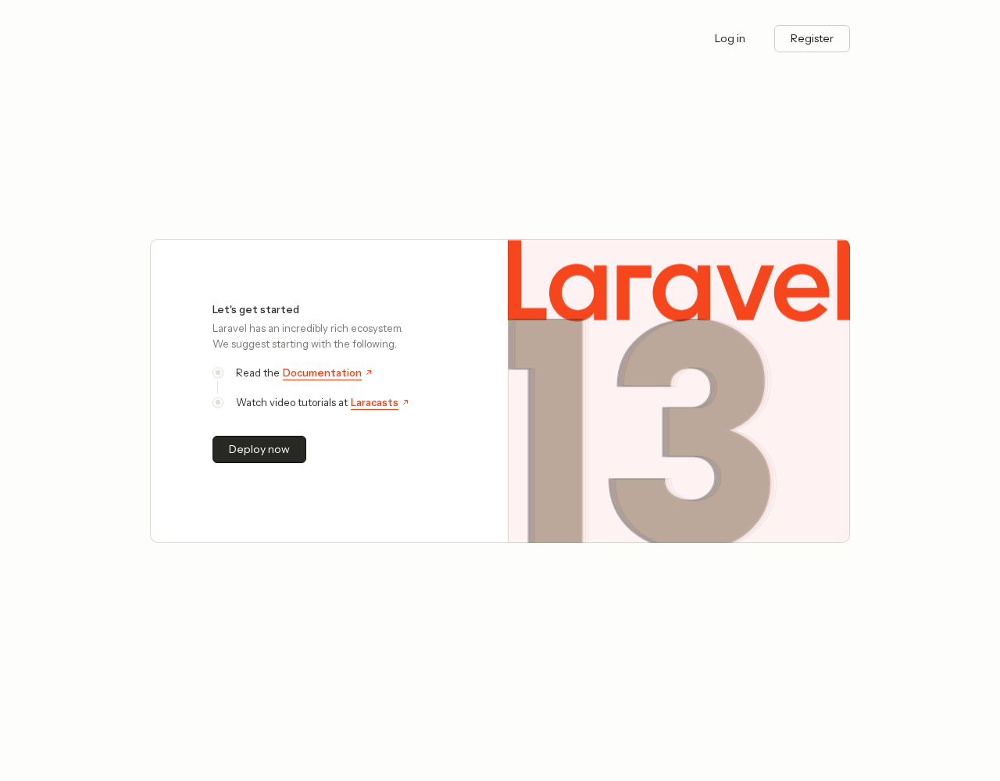

## Database driver requirement

Set `SESSION_DRIVER=database` to use this kit's session list and revocation features. This is the default configuration.

Revoking a session invalidates a stored login so it can no longer access authenticated pages. This kit reads a user's sessions from the database session table and deletes the selected records.

:::caution[Revocation is unavailable with Redis, Memcached, and other drivers]
The application can use `redis`, `memcached`, `file`, `cookie`, or other session drivers when their storage is configured. However, this kit's session list and revocation features support only `database`. It does not search for or delete sessions in other backends.

This restriction applies to individual revocation, revoking other sessions, revoking all sessions, and the operator CLI command.
:::

For other drivers, the settings page explains that session management is unavailable and hides the list and revocation controls. The operator command also exits with a driver requirement error.

The following screenshot was captured after switching to `SESSION_DRIVER=file`, signing in again, and opening `/settings/sessions`.

<figure>



<figcaption>Session management is unavailable with the file driver</figcaption>
</figure>

With the same configuration, the command below prints the requirement message and exits with code `1` without revoking sessions.

```sh
php artisan security:revoke-sessions email:test@example.com --force
```

```text
Session revocation requires the database session driver.
```

### Preparing the session database

Configure `.env`:

```dotenv
SESSION_DRIVER=database
```

The initial migration includes the `sessions` table. Run the migrations during setup.

```sh
php artisan migrate
```

By default, sessions use the application's default database connection and the `sessions` table. To change them, set `SESSION_CONNECTION` and `SESSION_TABLE`, as read by `config/session.php`, and create the session table in that location.

If configuration is cached, rebuild it after changing `.env`.

```sh
php artisan config:cache
```

Switching drivers does not migrate existing sessions. Users need to sign in again. Revocation in the new backend does not delete sessions left in the previous one.

## Listing and revoking sessions in settings

Open `/settings/profile` and select “`Sessions`” from the settings menu.

<figure>



<figcaption>Open session management through “<code>Sessions</code>” in profile settings</figcaption>
</figure>

### Identity confirmation before opening session management

In addition to being signed in, opening `/settings/sessions` requires password confirmation. Enter the current “`Password`” and select “`Confirm password`”. If a passkey is registered, “`Confirm with passkey`” is also available.

<figure>



<figcaption>Identity confirmation protects both the session list and revocation</figcaption>
</figure>

This check makes it harder for someone using a stolen session to inspect session details or sign the account owner out on another device.

Confirmation lasts **15 minutes** for session management. Within that window, confirmation is not requested again for each operation. After it expires, the list and revocation operations require another confirmation.

Excluding “`Password confirmation`” through [Chisel](https://github.com/laravel/chisel) also removes the browser session management page.

### Reviewing active sessions

After confirmation, “`Active sessions`” shows the current session and other signed-in sessions. The browser in use is marked “`Current session`”; other sessions appear under “`Other sessions`”.

<figure>



<figcaption>The current session and other active sessions</figcaption>
</figure>

Each entry shows an estimated browser and OS, a masked IP address, and the last activity time. Requests using a copied session cookie can appear as the same session.

The red arrow identifies the session to revoke in the next example.

### Revoking one session

Select its trash icon to open “`Revoke this session?`”.

<figure>



<figcaption>Confirmation before revoking the selected session</figcaption>
</figure>

This deletes the selected session and invalidates “`Remember me`” sign-ins across all browsers. Other active sessions remain signed in.

No second password entry is required while identity confirmation is fresh. Select “`Revoke session`” to proceed.

<figure>



<figcaption>After revocation, three other sessions remain</figcaption>
</figure>

Check for “`Session revoked.`” and the disappearance of the selected session. The current browser remains signed in.

### Revoking other sessions

Select “`Revoke other sessions`” to open “`Revoke all other sessions?`”.

<figure>



<figcaption>Confirmation before revoking all other sessions</figcaption>
</figure>

Confirm with “`Revoke other sessions`”. This keeps the current session, removes the others, and invalidates “`Remember me`” sign-ins.

<figure>



<figcaption>After revocation, the current session remains and other sessions total zero</figcaption>
</figure>

Check for “`Other sessions revoked.`” and “`There are no other active sessions.`”. You can continue using the current browser.

### Revoking every session, including the current one

Select “`Revoke all sessions`” to open “`Revoke every session?`”. This action also signs out the current browser.

<figure>



<figcaption>Confirmation before revoking every session</figcaption>
</figure>

Confirm with “`Revoke all sessions`”. All sessions and “`Remember me`” sign-ins are invalidated. This browser is signed out and returns to the application's home page.

<figure>



<figcaption>After all sessions are revoked, this browser is also signed out</figcaption>
</figure>

Opening session management again leads to login. Sign in again to continue.

## Revoking sessions from the CLI

Operators with access to the application runtime and database can run `security:revoke-sessions` to revoke every session of a specified user. It requires `SESSION_DRIVER=database`.

There is no browser password confirmation. Target selection and confirmation happen in the terminal. Run commands from the project root; with Sail, replace `php artisan` with `./vendor/bin/sail artisan`.

### Selecting the user

Prefix an email address with `email:` or a user ID with `id:`. This example targets the local `test@example.com` account.

```sh
php artisan security:revoke-sessions email:test@example.com
```

The prompt shows the name, email, ID, and stored session count. In this example, user ID `1` had one stored session.

```text
Revoke 1 session(s) for Test User (test@example.com, ID 1)? (yes/no) [no]:
> yes

Revoked 1 session(s) for user ID 1.
```

Check the target and enter `yes`. The default is `no`: pressing Enter cancels and prints “`No sessions were revoked.`”. To select the same user by ID:

```sh
php artisan security:revoke-sessions id:1
```

### State after execution

The command deletes all stored sessions for the target and invalidates “`Remember me`” sign-ins. Unlike “`Revoke other sessions`” in settings, it cannot preserve a selected session. Browsers are asked to sign in again on their next request to an authenticated page.

In the demonstrated environment, both stored and active session counts were checked in the database and were `0` after execution. The operation does not immediately close an already-open browser page.

CLI counts include expired stored records; the settings list includes only active sessions, so counts can differ. Even with zero stored sessions, confirmation still triggers the “`Remember me`” reset.

### Skipping confirmation

Use `--force` for automation or other cases that do not need the prompt.

```sh
php artisan security:revoke-sessions email:test@example.com --force
```

This skips only confirmation. Selector format, user existence, and the database driver requirement are still validated.

### Errors and partial results

An invalid selector, unknown user, unsupported session driver, or unavailable storage produces an error and exit code `1`. Success and cancellation at the prompt return `0`.

If session deletion fails after “`Remember me`” has already been reset, the output reports that partial result. Inspect the message, fix the cause, and retry. Session revocation ends existing logins; it does not suspend the account or prohibit a fresh login with valid credentials.
